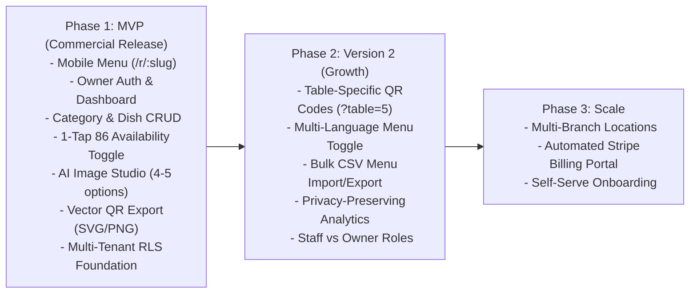

# DigiNu 🍽️
### Reusable QR-Based Digital Restaurant Menu Platform with AI Culinary Studio

[](#)
[](#)
[](#)
[](#)

---

## 📌 Executive Summary

**DigiNu** is a commercial-grade, white-label digital restaurant menu management platform designed for freelance developers and digital agencies to sell to independent restaurants, bistros, cafes, and bars.

It modernizes traditional paper and laminated dining menus into lightning-fast, mobile-first digital menus accessible instantly via table QR codes. The platform eliminates costly re-printing runs, empowers restaurant operators to 86 sold-out dishes in 1 tap, and features a built-in **AI Food Image Studio** that generates 4–5 studio-grade culinary photography options per dish.

---

## 🏛️ Dual-Interface Architecture

DigiNu is strictly bifurcated into two independent, isolated web experiences:

```
+-----------------------------------------------------------------------------------------+
|                                    DIGINU PLATFORM                                      |
+-----------------------------------------------------------------------------------------+
| INTERFACE A: PUBLIC CUSTOMER MENU          | INTERFACE B: PRIVATE OWNER DASHBOARD       |
| (Mobile-First • Read-Only • Zero Install)  | (Authenticated • No-Code Management)       |
|--------------------------------------------|--------------------------------------------|
| 📱 Target: Diner seated at table           | 💻 Target: Restaurant Owner / Floor Mgr    |
| ⚡ Speed: < 1.5s First Load on 4G Mobile   | 🛡️ Security: Scoped to tenant restaurant_id|
| 🔍 Browsing: Sticky scroll-spy category bar| 📋 Catalog: Full Category & Dish CRUD      |
| 🥗 Awareness: Veg/Non-Veg, Allergens, Tags | ⚡ Operations: 1-Tap 'Sold Out (86)' Switch|
| 🚫 Sold Out: 50% opacity & clear badge     | 🎨 Theming: Logo, Colors, Background Theme |
| 🔎 Discovery: Instant client-side search   | 🤖 AI Studio: 4-5 Culinary Photo Options   |
| 🚫 Zero Login: 100% anonymous & no cookies | 🖨️ QR Studio: Download Vector SVG & PNG   |
+-----------------------------------------------------------------------------------------+
```

---

## 🎯 Strict Product Scope & Guardrails

To preserve product focus and commercial viability for small restaurants and a solo developer, strict scope boundaries are enforced:

```
+-----------------------------------------------------------------------------------------+
|                                   SCOPE BOUNDARIES                                      |
+-----------------------------------------------------------------------------------------+
| IN SCOPE (Digital Menu Management)         | EXPLICITLY OUT OF SCOPE (Strictly Excluded)|
|--------------------------------------------|--------------------------------------------|
| ✅ Public mobile-first digital menu        | ❌ Shopping cart & checkout                |
| ✅ Table QR code generation & vector export| ❌ Online order placement & delivery       |
| ✅ Category & food item CRUD               | ❌ Payment gateways & transaction fees     |
| ✅ Real-time dish availability (86 toggle) | ❌ Kitchen Display Systems (KDS / KOT)     |
| ✅ Dietary badges & allergen checklists    | ❌ Point of Sale (POS) hardware sync       |
| ✅ AI food image generator (4-5 options)   | ❌ Raw ingredient inventory tracking       |
| ✅ White-label branding & theme presets    | ❌ Customer user accounts or loyalty pts   |
| ✅ Authenticated owner management portal   | ❌ Table reservation booking engine        |
+-----------------------------------------------------------------------------------------+
```

> **Core Operating Rule:** Diners use DigiNu exclusively to browse dishes. Orders are placed verbally with human waitstaff.

---

## 🤖 The Core Differentiator: AI Food Image Studio

Independent restaurants rarely have $1,500–$5,000 for professional culinary photography. DigiNu solves this with an integrated AI generation pipeline:

1. **Prompt Synthesis:** Converts dish name, description, ingredients, and cuisine style into an authentic food-photography prompt (45-degree angle, macro culinary lighting, fresh garnish, artisanal plating, negative constraints).
2. **Multi-Variation Generation:** Automatically generates **4 to 5 unique visual options** for the dish.
3. **Interactive Side-by-Side Review:** Owners preview candidate options with zoom capability.
4. **Mandatory Human Approval:** Owners explicitly approve their preferred variation before anything is published. AI images are **never** automatically assigned.
5. **WebP Optimization:** Approved images are transcoded to WebP (thumbnail + high-res) and stored in the restaurant's media bucket.

---

## 📂 Project Documentation Index

The complete product definition is thoroughly documented across structured phases:

```
DigiNu/
├── README.md
├── docs/
│   ├── 00-discovery/                                   # PHASE 00: DISCOVERY & STRATEGY
│   │   ├── 00-product-context.md                       # Vision, problem, business model & scope
│   │   ├── 01-product-model-and-tenant-strategy.md     # Single vs multi-tenant & isolation
│   │   ├── 02-public-digital-menu.md                   # Customer mobile experience & UX
│   │   ├── 03-owner-dashboard-and-menu-management.md   # Admin modules & operational CRUD
│   │   ├── 04-ai-image-generation.md                   # AI culinary studio & cost controls
│   │   ├── 05-security-and-privacy.md                  # Public/private boundaries & sanitization
│   │   ├── 06-design-and-branding-requirements.md      # Dual design systems & theme tokens
│   │   ├── 07-mvp-and-product-roadmap.md               # MVP vs V2 roadmap & dependency graph
│   │   ├── 08-open-questions-and-decisions.md          # Architectural decisions log & open questions
│   │   └── 09-discovery-readiness.md                   # Readiness assessment: GREEN
│   │
│   └── 01-product-definition/                          # PHASE 01: PRD & SPECIFICATIONS
│       ├── 01-product-requirements-document.md         # Master PRD (FR-MENU, FR-AUTH, FR-AI, etc.)
│       ├── 02-user-stories-and-acceptance-criteria.md  # BDD Given/When/Then user stories
│       ├── 03-sitemap-and-user-flows.md                # System navigation & 4 Mermaid flows
│       ├── 04-low-fidelity-wireframes.md               # Technology-neutral ASCII layout wireframes
│       ├── 05-mvp-and-quality-requirements.md          # Non-functional requirements (NFRs)
│       └── 06-open-decisions-and-requirements-checklist.md # Traceability matrix & gate check
```

---

## 💼 Freelancer Commercialization & Monetization Model

DigiNu is structured to provide high recurring gross margins for a solo freelance developer:

* **Setup & Onboarding Fee ($300 – $750 one-time):** Digital menu digitization, branding setup, and initial AI photography generation.
* **Monthly SaaS Retainer ($29 – $69/month per venue):** Cloud hosting, unlimited customer scans, dashboard access for real-time price & menu editing.
* **AI Credit Top-Up Packs ($15 per 20 credits):** Healthy margin over upstream API costs (~$0.03–$0.08 per generation batch).
* **Physical Table QR Kit Add-On ($100 – $250):** Delivery of custom acrylic table tents or wooden QR blocks.

---

## 🗺️ Product Roadmap



---

## 🔒 Security & Privacy Guarantees

* **Strict Read-Only Public Route:** Public dining endpoints cannot trigger database mutations.
* **Payload Sanitization:** Owner emails, password hashes, and draft items are never leaked in public JSON.
* **Tenant Isolation:** Enforced via `restaurant_id` foreign keys and Row-Level Security (RLS).
* **Zero Diner Tracking:** Diners are 100% anonymous; zero tracking cookies or PII collected.
* **Asset Upload Security:** Byte-level MIME sniffing, EXIF/GPS metadata stripping, and WebP transcoding.

---

## 🚦 Project Phase Status

* [x] **Phase 00: Product Discovery & Requirements Engineering** — `COMPLETE (GREEN)`
* [x] **Phase 01: Product Definition & Developer-Ready PRD** — `COMPLETE (DRAFT — REVIEW REQUIRED)`
* [ ] **Phase 02: Solution Architecture, Data Modeling & API Design** — `PENDING STAKEHOLDER APPROVAL`

---

*DigiNu — High-Speed Digital Menus with Intelligent Culinary Visuals.*

