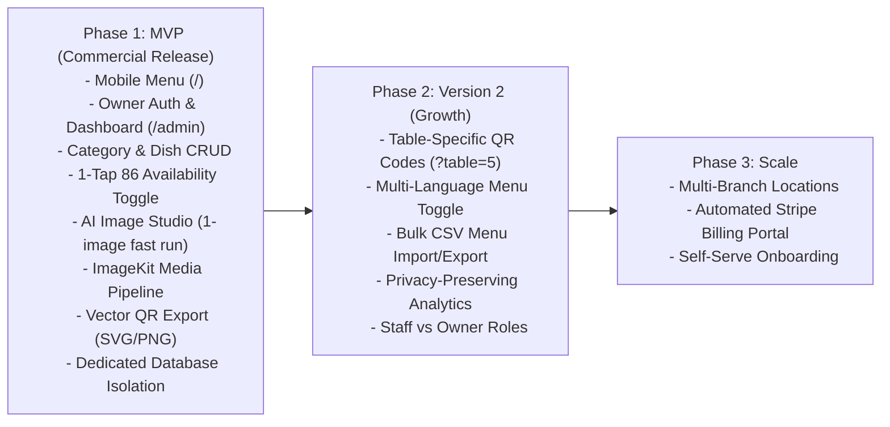

# DigiNu 🍽️
### Reusable QR-Based Digital Restaurant Menu Platform with AI Culinary Studio

[](#)
[](#)
[-green.svg)](#)
[](#)

---

## 📌 Executive Summary

**DigiNu** is a commercial-grade, white-label digital restaurant menu management platform designed for freelance developers and digital agencies to sell to independent restaurants, bistros, cafes, and bars.

It modernizes traditional paper and laminated dining menus into lightning-fast, mobile-first digital menus accessible instantly via table QR codes. Built on an **Independent Deployments** architecture using **one central reusable codebase**, each restaurant receives its own dedicated application container, isolated PostgreSQL database, custom domain, and table QR code. The platform eliminates costly re-printing runs, empowers restaurant operators to 86 sold-out dishes in 1 tap, and features a built-in **AI Food Image Studio** generating studio-grade culinary photography (1 high-res image per request).

---

## 🏛️ Dual-Interface Architecture

DigiNu is strictly bifurcated into two independent, isolated web experiences:

```
+-----------------------------------------------------------------------------------------+
|                    DIGINU PLATFORM (INDEPENDENT CLIENT DEPLOYMENT)                      |
+-----------------------------------------------------------------------------------------+
| INTERFACE A: PUBLIC CUSTOMER MENU          | INTERFACE B: PRIVATE OWNER DASHBOARD       |
| (Mobile-First • Read-Only • Zero Install)  | (Authenticated • No-Code Management)       |
|--------------------------------------------|--------------------------------------------|
| 📱 Target: Diner seated at table           | 💻 Target: Restaurant Owner / Floor Mgr    |
| ⚡ Speed: < 1.0s First Load on 4G Mobile   | 🛡️ Security: Dedicated Database Isolation  |
| 🔍 Browsing: Sticky scroll-spy category bar| 📋 Catalog: Full Category & Dish CRUD      |
| 🥗 Awareness: Veg/Non-Veg, Allergens, Tags | ⚡ Operations: 1-Tap 'Sold Out (86)' Switch|
| 🚫 Sold Out: 50% opacity & clear badge     | 🎨 Theming: Logo, Colors, Background Theme |
| 🔎 Discovery: Instant client-side search   | 🤖 AI Studio: 1-Image Fast Generation (~3s)|
| 🚫 Zero Login: 100% anonymous & no cookies | 🖨️ QR Studio: Download Vector SVG & PNG   |
+-----------------------------------------------------------------------------------------+
```

---

## 🎯 Strict Product Scope & Guardrails

To preserve product focus and commercial viability for small restaurants and a solo developer, strict scope boundaries are enforced:

```
+-----------------------------------------------------------------------------------------+
|                                   SCOPE BOUNDARIES                                      |
+-----------------------------------------------------------------------------------------+
| IN SCOPE (Digital Menu Management)         | EXPLICITLY OUT OF SCOPE (Strictly Excluded)|
|--------------------------------------------|--------------------------------------------|
| ✅ Public mobile-first digital menu        | ❌ Shopping cart & checkout                |
| ✅ Table QR code generation & vector export| ❌ Online order placement & delivery       |
| ✅ Category & food item CRUD               | ❌ Payment gateways & transaction fees     |
| ✅ Real-time dish availability (86 toggle) | ❌ Kitchen Display Systems (KDS / KOT)     |
| ✅ Dietary badges & allergen checklists    | ❌ Point of Sale (POS) hardware sync       |
| ✅ AI food image generator (4-5 options)   | ❌ Raw ingredient inventory tracking       |
| ✅ White-label branding & theme presets    | ❌ Customer user accounts or loyalty pts   |
| ✅ Authenticated owner management portal   | ❌ Table reservation booking engine        |
+-----------------------------------------------------------------------------------------+
```

> **Core Operating Rule:** Diners use DigiNu exclusively to browse dishes. Orders are placed verbally with human waitstaff.

---

## 🤖 The Core Differentiator: AI Food Image Studio

Independent restaurants rarely have $1,500–$5,000 for professional culinary photography. DigiNu solves this with an integrated AI generation pipeline:

1. **Prompt Synthesis:** Converts dish name, description, ingredients, and cuisine style into an authentic food-photography prompt (45-degree angle, macro culinary lighting, fresh garnish, artisanal plating, negative constraints).
2. **1-Image High-Speed Generation:** Automatically generates **1 high-resolution culinary image** per run in ~3 seconds via Cloudflare Workers AI (`flux-1-schnell`), consuming only ~250 Neurons.
3. **Interactive Preview:** Owner inspects the generated photo in the dashboard modal.
4. **Mandatory Human Approval:** Owner clicks "Approve & Apply to Dish" (or "Regenerate" if unsatisfied). AI images are **never** automatically assigned.
5. **WebP Optimization:** Approved images are transcoded to WebP (thumbnail + high-res) and stored in ImageKit CDN.

---

## 📂 Project Documentation Index

The complete product definition is thoroughly documented across structured phases:

```
DigiNu/
├── README.md
├── docs/
│   ├── PROJECT_CONTEXT_INDEX.md                        # Master Index & AI Context Pointer
│   ├── 00-discovery/                                   # PHASE 00: DISCOVERY & STRATEGY
│   │   ├── 00-product-context.md                       # Vision, problem, business model & scope
│   │   ├── 01-product-model-and-tenant-strategy.md     # Single vs multi-tenant & isolation
│   │   ├── 02-public-digital-menu.md                   # Customer mobile experience & UX
│   │   ├── 03-owner-dashboard-and-menu-management.md   # Admin modules & operational CRUD
│   │   ├── 04-ai-image-generation.md                   # AI culinary studio & cost controls
│   │   ├── 05-security-and-privacy.md                  # Public/private boundaries & sanitization
│   │   ├── 06-design-and-branding-requirements.md      # Dual design systems & theme tokens
│   │   ├── 07-mvp-and-product-roadmap.md               # MVP vs V2 roadmap & dependency graph
│   │   ├── 08-open-questions-and-decisions.md          # Architectural decisions log & open questions
│   │   └── 09-discovery-readiness.md                   # Readiness assessment: GREEN
│   │
│   ├── 01-product-definition/                          # PHASE 01: PRD & SPECIFICATIONS
│   │   ├── 01-product-requirements-document.md         # Master PRD (FR-MENU, FR-AUTH, FR-AI, etc.)
│   │   ├── 02-user-stories-and-acceptance-criteria.md  # BDD Given/When/Then user stories
│   │   ├── 03-sitemap-and-user-flows.md                # System navigation & 4 Mermaid flows
│   │   ├── 04-low-fidelity-wireframes.md               # Technology-neutral ASCII layout wireframes
│   │   ├── 05-mvp-and-quality-requirements.md          # Non-functional requirements (NFRs)
│   │   └── 06-open-decisions-and-requirements-checklist.md # Traceability matrix & gate check
│   │
│   └── 02-technical-architecture/                     # PHASE 02: TECHNICAL ARCHITECTURE & DATA MODEL
│       ├── 01-technology-stack-decisions.md           # Stack matrix, PaaS/VPS hosting & ImageKit evaluation
│       ├── 02-system-architecture.md                  # Independent deployment architecture & component flows
│       ├── 03-data-model-and-erd.md                   # Single-restaurant PostgreSQL ERD & data dictionary
│       ├── 04-api-and-integration-contracts.md        # REST API contracts, Zod schemas & 1-image AI sequence
│       ├── 05-security-and-deployment.md              # Physical isolation threat model, PaaS/VPS hosting
│       ├── 06-environments-repository-and-git-plan.md # Repeatable onboarding guide, .env & upstream sync
│       ├── 07-implementation-roadmap-and-traceability.md # 9 milestones & end-to-end traceability matrix
│       ├── 08-risks-and-open-decisions.md             # Hosting costs (1, 5, 10 venues), ImageKit/AI limits
│       └── 09-phase-02-approval-checklist.md          # Phase 02 formal approval checklist
│
└── docs/03-design-system/                             # PHASE 03: UI/UX DESIGN, BRANDING & DESIGN SYSTEM
    ├── 00-phase-03-overview.md                        # Design mission, goals & dual-interface governance
    ├── 01-design-context-readback.md                  # Synthesis of previous phases & screen mappings
    ├── 02-brand-audit-and-visual-direction.md         # 3 visual directions (Modern Editorial default)
    ├── 03-digital-brand-guidelines.md                 # Master brand identity & white-label theming
    ├── 04-design-tokens.json                          # Valid semantic tokens (Color, Type, Space, Motion)
    ├── 05-typography-and-content-style.md             # Modular type scale & culinary copywriting rules
    ├── 06-layout-grid-and-responsive-rules.md         # Breakpoints (360px–1024px) & safe area insets
    ├── 07-component-library-specification.md          # 16 atomic components with props, variants & states
    ├── 08-customer-screen-specifications.md           # 6 public customer menu screens (SCR-CUST-01 to 06)
    ├── 09-admin-screen-specifications.md              # 9 owner dashboard screens (SCR-ADMIN-01 to 09)
    ├── 10-interaction-and-motion-guidelines.md        # Motion tokens, spring physics & reduced-motion rules
    ├── 11-accessibility-design-checklist.md          # WCAG 2.2 AA checklist (contrast >= 4.5:1, 44px targets)
    ├── 12-imagery-and-asset-guidelines.md             # ImageKit WebP recipes & AI prompt synthesis formulas
    ├── 13-prototype-and-usability-review.md           # Heuristic review & interactive HTML artifact
    ├── 14-design-qa-and-handoff-checklist.md          # Engineering handoff & Tailwind config mappings
    ├── 15-design-decisions-and-skill-register.md      # Registered design choices & generative_ui tooling
    ├── 16-design-open-questions-and-change-requests.md# Open decisions & AI batching change request
    └── 17-phase-03-approval-checklist.md              # Phase 03 formal approval checklist
```

---

## 💼 Freelancer Commercialization & Monetization Model

DigiNu is structured to provide high recurring gross margins for a solo freelance developer:

* **Setup & Onboarding Fee ($300 – $750 one-time):** Digital menu digitization, branding setup, and initial AI photography generation.
* **Monthly SaaS Retainer ($29 – $69/month per venue):** Cloud hosting, unlimited customer scans, dashboard access for real-time price & menu editing.
* **AI Credit Top-Up Packs ($15 per 20 credits):** Healthy margin over upstream API costs (~$0.03–$0.08 per generation batch).
* **Physical Table QR Kit Add-On ($100 – $250):** Delivery of custom acrylic table tents or wooden QR blocks.

---

## 🗺️ Product Roadmap



---

## 🔒 Security & Privacy Guarantees

* **Strict Read-Only Public Route:** Public dining endpoints cannot trigger database mutations.
* **Payload Sanitization:** Owner emails, password hashes, and draft items are never leaked in public JSON.
* **Physical Database Isolation:** Dedicated database per restaurant eliminates cross-tenant data leakage risks.
* **Zero Diner Tracking:** Diners are 100% anonymous; zero tracking cookies or PII collected.
* **Asset Upload Security:** Byte-level MIME sniffing, EXIF/GPS metadata stripping, and WebP transcoding via ImageKit.

---

## 🚦 Project Phase Status

* [x] **Phase 00: Product Discovery & Requirements Engineering** — `COMPLETE (GREEN)`
* [x] **Phase 01: Product Definition & Developer-Ready PRD** — `COMPLETE (APPROVED BASELINE)`
* [x] **Phase 02: Technical Architecture, Data Modeling & API Design** — `COMPLETE (APPROVED BASELINE)`
* [x] **Phase 03: Premium UI/UX Design, Branding & Design System** — `COMPLETE (DRAFT — REVIEW REQUIRED)`
* [ ] **Phase 04: Implementation & Development (Milestones 1–9)** — `WAITING FOR PHASE 03 APPROVAL`

---

*DigiNu — High-Speed Digital Menus with Intelligent Culinary Visuals.*

