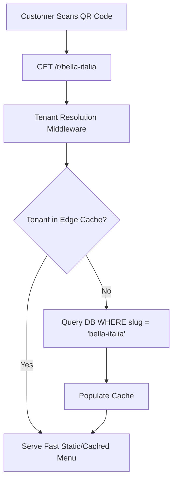
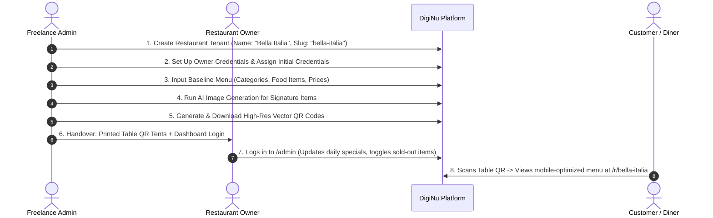

# 01 — Product Model & Multi-Tenant Strategy

**Document Version:** 1.0  
**Phase:** 00 — Product Discovery  
**Project:** DigiNu — Reusable QR-Based Digital Restaurant Menu Platform  

---

## 1. Architectural Dilemma: Independent Deployments vs. Multi-Tenant Platform

To commercialize DigiNu across dozens of local restaurants as a solo freelancer, the architectural model must balance **speed of initial delivery**, **operational overhead**, **security**, and **long-term maintainability**.

We evaluate two core paradigms:
1. **Option A — Independent Deployments (Single-Tenant Template):** Separate runtime instance and separate database deployed per restaurant (e.g., each restaurant gets its own Docker container / Vercel project and isolated database instance or Supabase/PostgreSQL database).
2. **Option B — Shared Multi-Tenant Platform:** Single unified codebase and shared database cluster serving all restaurants, segregated logically via `restaurant_id` tenant keys, row-level security (RLS), and custom routing (slug or custom domain).

---

## 2. Comparative Trade-Off Matrix

| Dimension | Option A: Independent Deployments (Per-Restaurant) | Option B: Multi-Tenant Platform (Logical Tenant Isolation) | Analysis for Solo Freelancer |
| :--- | :--- | :--- | :--- |
| **Development Complexity** | **Low-Medium**<br>No tenant routing or cross-tenant data leakage risks. Simple queries without `WHERE restaurant_id = ?`. | **Medium-High**<br>Requires tenant resolution middleware, strict row-level security, tenant-scoped caching, and tenant context propagation. | Option A is faster for client #1, but Option B creates a true scalable SaaS platform. |
| **Hosting & Infrastructure Costs** | **High at scale**<br>Each client requires independent container/compute resources and separate DB instances. 30 clients = 30 DBs and 30 web hosts ($200–$600+/mo). | **Very Low per client**<br>Single managed DB (PostgreSQL) and single web cluster handles hundreds of low-traffic restaurant menus ($20–$50/mo total). | **Option B is 5x–10x cheaper** on monthly cloud infrastructure. |
| **Maintenance & Code Updates** | **Extremely Painful**<br>Pushing a bugfix or new feature requires merging/deploying across 30+ separate Git repositories or CI pipelines. | **Seamless**<br>Deploy once; all restaurants instantly receive bug fixes, performance updates, and new features. | **Option B is vastly superior** for a solo maintainer. |
| **Security & Data Isolation** | **Absolute (Physical)**<br>Zero risk of Restaurant A reading Restaurant B's data because databases are physically separated. | **Logical (Cryptographic / RLS)**<br>Relies on strict database policies, foreign key scoping, and automated tests to prevent cross-tenant leakage. | Option A has an edge in compliance; Option B is secure if standard Row-Level Security (RLS) is applied. |
| **Customization Flexibility** | **Very High**<br>Can alter code, custom styling, or business logic directly for a single restaurant without impacting others. | **Config-Driven**<br>Customizations must be parameterized via settings JSON, themes, and feature toggles. | Option B forces clean abstraction and prevents messy code divergence. |
| **Restaurant Onboarding Speed** | **Slow (1–3 hours)**<br>Spin up new repo, provision cloud database, set DNS, configure environment variables, deploy. | **Instant (< 2 minutes)**<br>Insert a row into `restaurants` table; generate admin invite link; ready immediately. | **Option B allows instant zero-touch onboarding**. |
| **AI API Cost Management** | Fragmented across 30 API keys or manual billing. | Centralized billing with per-tenant quota enforcement and usage tracking. | Centralized tracking in Option B prevents runaway billing. |

---

## 3. Recommended Architectural Model: Hybrid Multi-Tenant Platform `[RECOMMENDATION]`

### 3.1 The Recommendation
**Option B (Single Codebase, Multi-Tenant Database with Row-Level Isolation)** is definitively recommended for DigiNu.

### 3.2 Why Multi-Tenancy is the Correct Choice for a Solo Freelancer
1. **Maintenance Sanity:** As a solo developer, managing 15, 30, or 50 distinct deployments will quickly consume 100% of your time just updating dependencies and hotfixing bugs. With multi-tenancy, you maintain **one Git repository, one staging environment, and one production cluster**.
2. **Favorable Unit Economics:** Digital restaurant menus are read-heavy, low-write, low-compute workloads. 99% of restaurant traffic is diners reading static menu JSON. A single PostgreSQL database with connection pooling and edge caching can comfortably serve 500+ restaurants at virtually negligible cost.
3. **Instant Self-Serve / Admin Onboarding:** You can onboard a new restaurant in 60 seconds from your master dashboard, rather than provisioning cloud infrastructure.
4. **Isolated Customization via White-Label Configuration:** Deep customization is achieved cleanly through structured configuration (color palettes, font pairings, banner layouts, currency formats) stored in the database, avoiding hardcoded client forks.

---

## 4. Tenant Isolation Architecture `[CONFIRMED]`

To guarantee that Restaurant A cannot access, query, or mutate Restaurant B's categories, food items, images, or configuration:

### 4.1 URL & Tenant Resolution Strategy
Every restaurant is assigned a unique, immutable URL slug:
* **Standard URL Route:** `https://diginu.app/r/{restaurant_slug}` (Public Menu)
* **Custom Subdomain (Optional / Future):** `https://{restaurant_slug}.diginu.app`
* **Custom Domain (Optional / Future):** `https://menu.thegrillhouse.com`
* **Admin Dashboard Route:** `https://diginu.app/admin` (Scoped to the authenticated owner's tenant session).



### 4.2 Database Isolation Layer
* **Tenant Scoping Key:** Every tenant-scoped entity (`categories`, `food_items`, `food_images`, `qr_codes`, `audit_logs`) contains a mandatory, indexed foreign key `restaurant_id UUID NOT NULL REFERENCES restaurants(id) ON DELETE CASCADE`.
* **Row-Level Security (RLS) / Scoped Data Access:**
  * For administrative operations: Database queries must automatically enforce `restaurant_id = auth.current_tenant_id()`.
  * For public customer queries: Queries filter strictly by verified `restaurant_id` associated with the active public slug. Public endpoints only return items marked `is_visible = true`.

---

## 5. White-Label Configuration Model `[CONFIRMED]`

To ensure the platform remains 100% white-label and zero restaurant-specific data is hardcoded in the codebase, all presentation details are modeled as tenant configuration attributes:

```
+-----------------------------------------------------------------------------------+
|                        RESTAURANT CONFIGURATION SCHEMA                            |
+-----------------------------------------------------------------------------------+
| Attribute Group       | Dynamic Fields Stored in Database                         |
|-----------------------|-----------------------------------------------------------|
| Identity & Branding   | - Restaurant Name, Slug, Short Description, About Story   |
|                       | - Logo URL (Light/Dark variants), Cover Banner URL        |
| Visual Theme          | - Primary Brand Color (HEX / HSL)                         |
|                       | - Secondary Accent Color                                  |
|                       | - Background Tone (Clean White, Soft Cream, Dark Charcoal)|
|                       | - Typography Preset (Modern Sans, Classic Serif, Elegant)  |
| Regional Settings     | - Currency Code (USD, EUR, GBP, INR, CAD, etc.)          |
|                       | - Currency Symbol position ($XX vs XX €)                  |
|                       | - Primary Language (English default)                      |
| Location & Contact    | - Physical Address, Map Pin / Coordinates                 |
|                       | - Phone Number, WhatsApp Contact, Email                   |
|                       | - Social Media Links (Instagram, Facebook, Google Maps)   |
| Operating Hours       | - Weekly opening/closing schedule per day                 |
| Layout Preferences    | - Card Style: Compact List vs. Large Visual Grid Cards    |
+-----------------------------------------------------------------------------------+
```

---

## 6. End-to-End Restaurant Onboarding Workflow

The operational lifecycle for introducing a new restaurant into DigiNu:



### Onboarding Steps Breakdown `[RECOMMENDATION]`
1. **Contract & Paper Menu Handover:** Freelancer collects current paper menu, high-res logo file, and brand colors from restaurant owner.
2. **Tenant Provisioning:** Freelancer logs into Master Admin or executes seeding script to create restaurant record.
3. **Menu Digitization:** Input categories (Starters, Mains, Desserts, Beverages) and dishes with pricing.
4. **AI Visual Enhancement:** Generate 4–5 appetizing AI image variations for signature dishes lacking photography, approve the best, and link them.
5. **QR Code Artifact Generation:** Export high-resolution SVG/PDF QR codes embedded with restaurant branding.
6. **Physical Collateral Delivery:** Print table acrylic stands or stickers and deliver to the venue.
7. **Client Handover & Empowerment:** Provide restaurant owner with login credentials to `/admin`. Owner can now independently adjust prices or 86 sold-out dishes on the fly.

