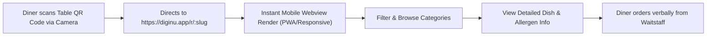

# 02 — Public Digital Menu Experience

**Document Version:** 1.0  
**Phase:** 00 — Product Discovery  
**Project:** DigiNu — Reusable QR-Based Digital Restaurant Menu Platform  

---

## 1. UX Vision & Design Philosophy

The **Public Digital Menu** is the primary customer touchpoint of the DigiNu platform. It is engineered with a strict **mobile-first, zero-friction, read-only philosophy**:

* **Zero Friction:** No app installation required, no customer accounts, no email/phone capture popups, and zero cookie-consent walls.
* **Instant Gratification:** Sub-second page load times on standard mobile 4G/5G connections.
* **Appetite-Centric Aesthetics:** Generous, crisp food imagery, clean typographic hierarchy, and intuitive gestures.
* **Strict Read-Only Architecture:** Completely detached from checkout, payments, or administrative controls. Diners use the digital menu to decide on their meal and place their order verbally with the restaurant's waitstaff. `[CONFIRMED]`

---

## 2. Customer QR Entry Workflow



### 2.1 URL Routing Specifications `[CONFIRMED]`
* **Canonical URL Pattern:** `https://diginu.app/r/{restaurant-slug}` (e.g., `https://diginu.app/r/trattoria-da-luigi`)
* **QR Target Resolution:** The QR code placed on physical tables encodes this exact canonical URL.
* **Fallback Behavior:** If an invalid or deactivated slug is scanned, the user is presented with a branded, courteous "Restaurant Menu Unavailable" fallback screen with a search or return link, preventing raw 404/500 errors.

---

## 3. UI Layout & Visual Presentation

### 3.1 Header & Restaurant Identity Section
* **Cover Banner (Optional):** High-aspect-ratio atmospheric photograph of the restaurant interior or hero dish.
* **Restaurant Logo & Avatar:** Clean circular or square framed logo overlaid seamlessly.
* **Restaurant Title & Meta:**
  * Restaurant Name (e.g., *Trattoria Da Luigi*)
  * Cuisine classification (e.g., *Authentic Italian • Wood-fired Pizza • Pasta*)
  * Current Operational Status Badge: Dynamic pill indicator (*"Open Now • Closes 10:00 PM"* or *"Currently Closed"* based on operating hours).
* **Collapsible Info Drawer:** Tapping the info icon reveals:
  * Physical address with a "Open in Google Maps" link.
  * Direct "Call Restaurant" button (`tel:+1...`).
  * Social links (Instagram handle, Website).
  * Wi-Fi credentials for guests (if provided by owner).

### 3.2 Category Navigation (Sticky Scroll-Spy) `[CONFIRMED]`
* **Sticky Category Bar:** As the customer scrolls down, an elegant horizontal category navigation bar snaps to the top of the mobile viewport.
* **Pill Chips / Tabs:** Visual chips displaying category names (e.g., *[All] [Antipasti] [Handmade Pastas] [Stone-baked Pizza] [Desserts] [Craft Cocktails]*).
* **Scroll-Spy & Auto-Centering:** The active category tab automatically highlights and smoothly centers itself horizontally as the diner scrolls through the corresponding vertical section of the menu.
* **Category Tap-to-Scroll:** Tapping a category tab triggers a smooth programmatic scroll directly to that category section.

---

## 4. Menu Item Display & Card Architecture

Each food item is rendered within an accessible, tactile card designed to showcase culinary appeal:

```
+---------------------------------------------------------------------------------+
| [Image: Crisp Crispy Calamari]                | [Popular Badge] [Gluten-Free]  |
|                                               +---------------------------------|
| Crispy Salt & Pepper Calamari                                      $16.50       |
| Lightly battered tender squid rings, tossed with sea salt, crushed peppercorns, |
| served with house-made smoked garlic aioli and grilled lemon wedge.             |
|                                                                                 |
| (V) Non-Veg  •  Allergens: Molluscs, Eggs, Gluten  •  Cal: 420 kcal             |
+---------------------------------------------------------------------------------+
```

### 4.1 Item Attributes & Visual Badges `[CONFIRMED]`
1. **Food Image:**
   * Optimized WebP format with responsive srcset.
   * Blur-up placeholder or shimmer skeleton while loading.
   * Graceful fallback placeholder if no image exists for the dish.
2. **Item Title & Typography:** Clear, high-contrast, legible header font.
3. **Price Tag:** Prominently displayed using the restaurant's configured currency symbol and format (e.g., `$18.00`, `€16,50`, `£14.00`, `₹450`).
4. **Description:**
   * Short description displayed on the main card (1–2 concise sentences).
   * Supports expanding to a full detailed description modal if tapped.
5. **Dietary & Lifestyle Badges:**
   * **Vegetarian / Non-Vegetarian Indicator:** Universal green dot in green square (Veg) vs. brown/red dot in square (Non-Veg) `[CONFIRMED]`.
   * **Dietary Chips:** `[Vegan]`, `[Gluten-Free]`, `[Halal]`, `[Keto]`, `[Dairy-Free]`, `[Spicy Level: 🌶️🌶️]`.
6. **Allergen Disclaimers:** Explicit tags for common allergens: *Contains Nuts, Dairy, Shellfish, Soy, Eggs, Gluten*.
7. **Merchandising Indicators:**
   * `[Chef's Special]` or `[Most Popular]` highlight badge for signature items.
8. **Item Availability Handling:**
   * If an item is marked "Sold Out" in the dashboard, the card displays a muted, semi-transparent overlay with a visible `[Sold Out Today]` or `[86'd]` badge. The item remains visible so diners know it is part of the repertoire, but clearly marked as unavailable to prevent ordering frustration. `[CONFIRMED]`

---

## 5. Menu Discovery & Search Experience

### 5.1 Real-Time Live Search `[CONFIRMED]`
* Sticky search bar positioned above or within the category header.
* **Instant Debounced Client-Side Filtering:** Instant search against item names, descriptions, and ingredients without making repeated server calls.
* **Clear State:** Instant reset button (`✕`) to return to full menu browsing.

### 5.2 Quick Dietary Filter Chips `[RECOMMENDATION]`
* Toggle filters allowing diners to filter dishes across all categories simultaneously:
  * `[🌱 Pure Veg Only]`
  * `[🌾 Gluten-Free]`
  * `[⭐ Chef's Picks]`
* When a filter is active, empty categories automatically hide, displaying only sections containing matching dishes.

### 5.3 Item Detail Modal / Bottom Drawer
* Tapping on an item card expands a fluid bottom sheet / modal.
* Provides high-resolution full-width image preview, comprehensive ingredient list, detailed allergen advisory, and preparation details (e.g., "Prepared in a facility handling peanuts").

---

## 6. Edge Cases & Defensive UX Handling

| Edge Case Scenario | Expected System Behavior | Status |
| :--- | :--- | :--- |
| **Empty Category** | Categories containing zero visible items are automatically omitted from public navigation and body. | `[CONFIRMED]` |
| **All Items in Category Sold Out** | Category header remains visible, but all contained cards reflect the `Sold Out` status badge. | `[CONFIRMED]` |
| **Restaurant Outside Operating Hours** | A gentle banner indicates: *"Restaurant is currently closed for dine-in. Hours: 12 PM - 10 PM."* Menu remains fully browsable. | `[RECOMMENDATION]` |
| **Slow Mobile 3G Connectivity** | Text content and skeleton loaders render first; images load lazily; overall layout does not experience cumulative layout shift (CLS). | `[CONFIRMED]` |
| **Missing Image for an Item** | Card renders in a compact, text-first elegant layout without broken image placeholders. | `[CONFIRMED]` |
| **Extremely Long Dish Names / Descriptions** | Responsive typography truncates gracefully with clean line clamps and expansion options. | `[CONFIRMED]` |

---

## 7. Performance & Quality Benchmarks

* **Performance Budget:** First Contentful Paint (FCP) < 1.0s, Largest Contentful Paint (LCP) < 1.8s on 4G mobile.
* **Accessibility:** WCAG 2.1 AA compliant contrast ratios for text and dietary badges.
* **Data Payload:** Compressed initial page payload < 350KB (excluding cached images).
* **Isolation Guarantee:** Zero dashboard code, admin APIs, or authorization tokens are bundled or exposed in the public menu bundle. `[CONFIRMED]`

