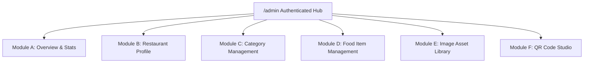

# 03 — Restaurant Owner Dashboard & Menu Management

**Document Version:** 1.0  
**Phase:** 00 — Product Discovery  
**Project:** DigiNu — Reusable QR-Based Digital Restaurant Menu Platform  

---

## 1. Executive Purpose & Architecture

The **Private Restaurant Owner Dashboard** is an authenticated, no-code administrative interface accessible at `https://diginu.app/admin`. It empowers non-technical restaurant managers, head chefs, and floor staff to control their public menu in real-time from any device (smartphone, tablet, or laptop).

### Key Architectural Tenets
* **Strict Server-Side Authorization:** Every mutation or data query is strictly scoped to the authenticated owner's `restaurant_id`. `[CONFIRMED]`
* **Operational Simplicity:** Purpose-built exclusively for menu management. Free of irrelevant ERP, inventory, accounting, or POS clutter. `[CONFIRMED]`
* **Instant Propagation:** Changes made in the dashboard reflect immediately on customer table menus without requiring rebuilds or cache purges.

---

## 2. Authentication & Session Security `[CONFIRMED]`

* **Credentials:** Email and strong password authentication with rate-limited login endpoints.
* **Session Management:** Secure HTTP-only, SameSite cookies or short-lived JWTs with automatic refresh.
* **Role Scoping:**
  * **Restaurant Owner / Staff:** Scoped exclusively to their single assigned restaurant tenant.
  * **Platform Super-Admin (Freelancer):** Global view across all restaurant tenants for onboarding and maintenance.
* **Password Recovery:** Standard self-serve email password reset workflow.

---

## 3. Dashboard Modules Breakdown

---

### Module A — Dashboard Overview `[CONFIRMED]`
A clean operational health card summarizing current menu status:
* **Metric Tiles:**
  * **Total Categories:** (e.g., `8 active categories`)
  * **Total Food Items:** (e.g., `64 items on menu`)
  * **Currently Available:** (e.g., `61 items active`)
  * **Currently Sold Out (86'd):** (e.g., `3 items marked sold out`)
  * **AI Generation Balance:** (e.g., `38 / 50 AI credits remaining this month`)
* **Quick Actions Row:**
  * `[+ Add New Food Item]`
  * `[View Live Public Menu ↗]`
  * `[Download Table QR Code]`
* **Recent Activity Feed:** Last 5 menu modifications (e.g., *"Crispy Calamari marked Sold Out at 1:15 PM by Chef Mario"*).

---

### Module B — Restaurant Profile Management `[CONFIRMED]`
Allows complete branding and operational customization without developer intervention:
* **Identity:** Restaurant Name, Canonical URL Slug preview (`diginu.app/r/restaurant-slug`), Tagline / Short Description, About Story.
* **Visual Assets:**
  * **Logo Uploader:** Support for PNG/JPG/SVG with built-in square/circle cropping preview.
  * **Cover Banner Uploader:** Support for wide hero banner images.
* **Brand Styling:**
  * Primary Brand Color picker (used for category highlights, accent buttons, and badges).
  * Background Theme selector (`Clean White`, `Warm Cream`, `Midnight Charcoal`).
  * Typography selector (`Modern Sans-Serif`, `Classic Editorial Serif`).
* **Location & Social:** Physical street address, Google Maps link, Contact Phone (with click-to-call), WhatsApp ordering/inquiry number, Instagram handle.
* **Operating Hours Table:** 7-day schedule editor with open/close time slots and "Closed Today" toggles.
* **Localization:** Currency selector (`$`, `€`, `£`, `₹`, `C$`, `A$`, `AED`, etc.), currency symbol placement (`Prefix $10` vs `Suffix 10 €`), and decimal format.

---

### Module C — Category Management `[CONFIRMED]`
Organizes dishes into logical dining sections (e.g., Starters, Mains, Pizzas, Desserts, Cocktails):
* **Create Category:** Modal or inline drawer to enter Category Name (e.g., *"Artisanal Pastas"*), Subtitle/Description (e.g., *"Handmade fresh daily using Italian 00 flour"*), and optional Category Icon/Image.
* **View & Reorder:** Drag-and-drop or up/down ordering arrows to dictate the exact order categories appear on the public menu.
* **Status Toggle:** Instantly toggle Category Visibility (`Active` vs. `Hidden/Seasonal`) to hide an entire seasonal section (e.g., "Summer Cocktails") with one click.
* **Delete Safeguard:** Prevents accidental deletion if a category contains active food items. System prompts owner to reassign or delete items first.

---

### Module D — Food Item Management `[CONFIRMED]`
The core operational workhorse of the administrative dashboard:

#### Attributes Managed Per Item
1. **Name:** Clear culinary title (e.g., *"Truffle Burrata Bruschetta"*).
2. **Category Assignment:** Dropdown linking item to an existing active category.
3. **Price:** Numeric input supporting decimals (e.g., `18.50`).
4. **Description:**
   * Short summary (visible on main card).
   * Detailed ingredients & preparation method (visible in expanded view).
5. **Food Image Assignment:** Three seamless pathways:
   * **Direct Upload:** Upload photo directly from phone camera or hard drive.
   * **Asset Library:** Select from previously uploaded or approved dishes.
   * **AI Generator:** Invoke integrated AI culinary generator to create 4–5 photo options.
6. **Dietary & Lifestyle Tags:**
   * Veg / Non-Veg toggle (with classic green/brown indicator).
   * Multi-select chips: `[Vegan]`, `[Gluten-Free]`, `[Halal]`, `[Nut-Free]`, `[Spicy 🌶️]`.
7. **Allergen Checklist:** Checkboxes for 14 major allergens (Milk, Eggs, Peanuts, Tree Nuts, Shellfish, Fish, Soy, Wheat, Celery, Mustard, Sesame, Sulphites, Lupin, Molluscs).
8. **Operational Status Toggles:**
   * **Availability:** `Available` vs. `Sold Out / 86'd` (instant single-tap toggle).
   * **Visibility:** `Published` vs. `Draft / Hidden`.
   * **Merchandising:** `Featured Item` / `Chef's Recommendation` badge.
9. **Sorting Order:** Position ranking within category.

---

### Module E — Image Asset Management `[CONFIRMED]`
A centralized gallery of all visual media associated with the restaurant:
* **Three Image Sourcing Pathways:**
  1. **Upload from Device:** Automatic client-side resize and conversion to modern WebP before upload.
  2. **Select from Existing Library:** Browse previous uploads and AI-generated assets with search and category tags.
  3. **Generate with AI:** Direct access to AI food image studio.
* **Image Inspection & Crop:** Ability to set focal point or crop ratio (1:1 square or 4:3 landscape).
* **Storage Optimization:** Server-side compression to ensure mobile customer menus load within < 1.5 seconds.
* **Asset Cleanup:** Secure deletion of unused images to prevent cloud storage bloat.

---

### Module F — QR Code Management Studio `[CONFIRMED]`
Generates print-ready table assets linked to the restaurant's public menu URL:
* **Deterministic URL Binding:** The QR code encodes the canonical menu URL (`https://diginu.app/r/{slug}`). Because the slug is permanent, the restaurant's physical QR codes never break, even if the menu changes daily.
* **Branded Customization Options `[RECOMMENDATION]`:**
  * Center Logo Embedding: Automatically embed the restaurant's square logo into the center of the QR code matrix.
  * Brand Color Theming: Custom foreground color matching the restaurant's brand palette.
  * Dot Styles: Sleek rounded dots or classic square matrix.
* **Print-Ready Export Formats `[CONFIRMED]`:**
  * **SVG (Scalable Vector Graphics):** High-fidelity format for professional commercial printing on banners or signs.
  * **PNG (High-Resolution 300 DPI):** Ready for standard office printing and digital use.
  * **PDF Table-Tent Template:** Downloadable pre-formatted A6 or 4x6 inch table card ready for immediate tabletop display.
* **Regeneration Guarantee:** The owner can re-download or regenerate visual styles at any time without altering the underlying menu URL.

