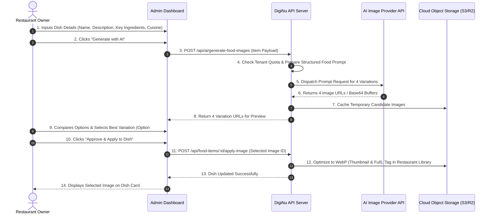

# 04 — AI-Powered Food Image Generation

**Document Version:** 1.0  
**Phase:** 00 — Product Discovery  
**Project:** DigiNu — Reusable QR-Based Digital Restaurant Menu Platform  

---

## 1. Feature Vision & Value Proposition

High-quality food photography is the single highest driver of dish conversion on restaurant menus. However, commercial food photography costs $1,500–$5,000 per session—a prohibitive expense for small local dining establishments.

The **AI Food Image Generator** is DigiNu's premier commercial differentiator. It allows restaurant owners to generate 4–5 studio-grade, hyper-realistic culinary image options for any dish on their menu in under 30 seconds, select their favorite, and publish it instantly to their public menu without external graphic designers or photographers. `[CONFIRMED]`

---

## 2. End-to-End Operational Workflow



### Detailed Workflow Step-by-Step `[CONFIRMED]`
1. **Context Extraction:** When the owner triggers generation, the system extracts the dish's name (e.g., *"Crispy Duck Confit"*), category (*"Entrees"*), description (*"Slow-cooked duck leg with spiced orange reduction and creamy polenta"*), and restaurant cuisine style (*"French Bistro"*).
2. **Automated Prompt Synthesis:** The backend applies an internal prompt-engineering template that guarantees commercial food-photography aesthetic standards.
3. **Multi-Variation Generation:** The system requests 4 distinct variations (or 4 sequential generations if batch size is constrained).
4. **Interactive Comparison Modal:** The dashboard displays all 4 variations in an interactive side-by-side comparison modal with zoom-inspection capability.
5. **Selection & Approval:** The owner explicitly clicks **"Select This Image"**.
6. **Persistence & Optimization:** The selected image is permanently persisted to cloud storage, compressed into optimized WebP formats (mobile thumbnail + high-res modal view), and attached to the food item record. Unselected candidate images are discarded after 24 hours.
7. **Strict Human-in-the-Loop Mandate:** Under no circumstances does the system automatically attach or publish an AI-generated image without explicit owner review and approval. `[CONFIRMED]`

---

## 3. Culinary Prompt Engineering Strategy `[RECOMMENDATION]`

To prevent bizarre, cartoonish, or unappetizing artifacts, raw user input is never sent directly to the AI model. Instead, it is synthesized through a specialized prompt template:

### 3.1 Prompt Synthesis Formula
```text
[Subject]: Professional commercial food photography of {dish_name}.
[Plating & Details]: {dish_description}, garnished with fresh culinary herbs, served on a high-end artisanal ceramic plate.
[Setting & Lighting]: Cozy upscale restaurant setting, soft cinematic natural window lighting, 45-degree angled macro culinary shot, shallow depth of field with creamy bokeh background, glistening textures, steam subtly rising.
[Quality Directives]: 8k resolution, Michelin-star presentation, hyper-realistic, authentic appetizing colors, photorealistic culinary magazine aesthetic.
```

### 3.2 Negative Prompts / Constraints (Where Supported)
* *Exclude:* Cartoon, 3D render, drawing, illustration, oversaturated, plastic food, artificial look, messy plating, distorted utensils, unnatural colors, blur, text, watermark, logo, hands, human faces.

---

## 4. AI Provider Evaluation & Comparative Analysis

| Provider & Model | Visual Realism for Food | Multi-Image Generation Cost | API Reliability & Latency | Recommendation for DigiNu |
| :--- | :--- | :--- | :--- | :--- |
| **OpenAI DALL-E 3** | High quality, occasionally slightly stylized/smooth. | ~$0.040 per standard image ($0.16 for 4 images). | Highly reliable, ~10s per generation. Only generates 1 image per call (requires 4 calls). | Strong candidate; easily available via standard OpenAI API. |
| **Google Imagen 3 (Vertex AI)** | Exceptional realism, excellent texture rendering for food and sauces. | ~$0.030 per image ($0.12 for 4 images). | High enterprise reliability, rapid generation (< 8s). | **Top Recommendation** for cost, speed, and photorealistic fidelity. |
| **FLUX.1 [schnell / dev] via Replicate or Together** | Superb photorealism, authentic culinary lighting, negligible styling artifacts. | ~$0.003 (schnell) to $0.025 (dev) per image ($0.012–$0.10 for 4 images). | Fast latency (2–4s for schnell), requires webhook or polling. | **Strong Alternative** for maximum cost savings for a solo freelancer. |
| **Stability AI (SD3 / Core)** | Good food quality, highly configurable. | ~$0.035 per image. | Good API stability. | Viable fallback option. |

> `[RECOMMENDATION]` **Provider Architecture:** Use an abstracted `ImageGenerationService` adapter interface in code. This allows the freelancer to start with **Google Imagen 3** or **OpenAI DALL-E 3**, while having the flexibility to switch to **Flux.1** or another provider via configuration without changing UI or database code.

---

## 5. Cost Management, Quotas & Abuse Prevention

Because image generation incurs real API expense, the system enforces strict safeguards:

1. **Per-Tenant Monthly Credit Quotas `[CONFIRMED]`:**
   * Each restaurant tenant is allocated a monthly generation balance (e.g., 30 AI generations/month included in their SaaS tier).
   * Generates 4 variations = 1 generation credit deduction.
   * If quota reaches 0, the dashboard prompts the owner to request a credit top-up pack from the freelancer.
2. **Double-Click & Concurrency Lock `[CONFIRMED]`:**
   * Generation button disables immediately upon click, displaying an animated cooking/generating indicator.
   * Mutex lock on the backend prevents a user from triggering parallel generation jobs for the same dish.
3. **Usage Logging & Audit Trail `[CONFIRMED]`:**
   * Every generation event is logged with: `timestamp`, `restaurant_id`, `food_item_id`, `provider_used`, `cost_estimate`, and `selected_image_id`.
4. **Transient Cache for Variations:**
   * Generated candidate images are stored in a temporary `/temp-ai/{restaurant_id}/` bucket. Only the approved image is moved to the permanent `/dishes/{restaurant_id}/` storage bucket.

---

## 6. Resilience & Graceful Degradation `[CONFIRMED]`

The platform must operate seamlessly even if the AI provider encounters downtime or API rate limits:
* **Decoupled Architecture:** Menu creation and editing are completely independent of the AI service. If the AI service fails or times out:
  * An empathetic toast notification is displayed: *"AI Kitchen is currently busy. You can upload an image manually or try again in a moment."*
  * The food item saves normally with default placeholder or owner-uploaded image.
  * No 500 error or page crash is exposed to the user.
* **Manual Upload Alternative:** Owners always retain the option to upload their own photo or select from existing library assets at any time.

