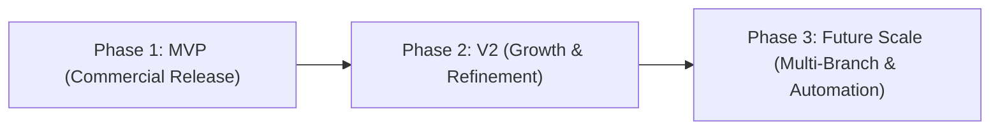
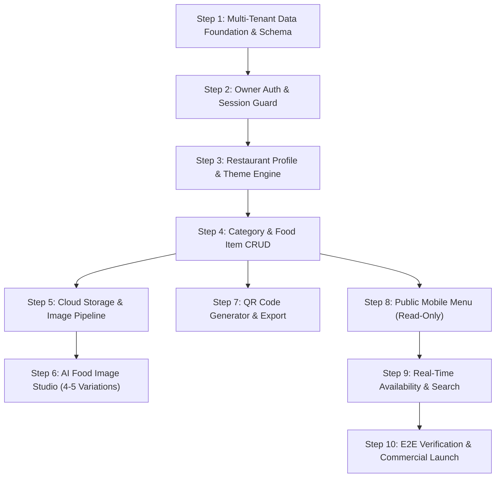

# 07 — MVP Scope, Product Roadmap & Prioritization

**Document Version:** 1.0  
**Phase:** 00 — Product Discovery  
**Project:** DigiNu — Reusable QR-Based Digital Restaurant Menu Platform  

---

## 1. Phasing Strategy

DigiNu is structured into three disciplined delivery horizons to ensure rapid commercial launch by a solo freelancer while laying the technical groundwork for long-term scalability:

---

## 2. Phase 1: MVP — First Commercial Release `[CONFIRMED]`

The minimum viable product necessary to deploy paying restaurant clients immediately.

### 2.1 Public Customer Menu
* Mobile-first responsive web application accessible via `https://diginu.app/r/:slug`.
* Restaurant branding display (logo, cover photo, name, description, address, contact, hours).
* Dynamic category navigation bar with sticky scroll-spy and tap-to-scroll.
* Rich food item cards with high-res food image, title, price, short description, and dietary tags.
* Veg / Non-Veg indicators and allergen tag pills.
* Instant client-side text search across dish titles and descriptions.
* Real-time item availability handling (greyed-out styling and `Sold Out` badge for 86'd dishes).
* Expanded item detail modal for full ingredients and allergen warnings.
* Sub-1.5 second loading speed with WebP optimized images and skeleton loading states.

### 2.2 Private Restaurant Owner Dashboard
* Secure authentication system (email/password with password reset and rate limiting).
* Dashboard overview with operational counts (total categories, items, sold-out count, AI credits).
* **Restaurant Profile Settings:** Name, slug, logo upload, cover banner, brand color picker, theme preset selector, currency, and operating hours.
* **Category CRUD:** Create, edit, reorder, and toggle visibility of menu categories.
* **Food Item CRUD:** Full management of dish name, description, price, category, dietary tags, allergens, and featured flags.
* **Item Availability Switch:** One-tap toggle to mark dishes as `Available` or `Sold Out / 86'd`.
* **Multi-Channel Image Management:**
  1. Direct photo upload with client-side preview.
  2. Integrated AI Food Image Studio: Generate 4–5 realistic culinary options, side-by-side preview, select, and apply.
  3. Reusable restaurant asset library.
* **QR Code Studio:** Generate, preview with centered logo, and download print-ready QR codes in vector SVG and high-resolution PNG formats.
* Multi-tenant data isolation guaranteeing strict boundary protection between restaurants.

---

## 3. Phase 2: Version 2 — Commercial Growth & Operational Polish `[RECOMMENDATION]`

Features designed to increase average revenue per user (ARPU) and operational efficiency after initial market validation:

1. **Table-Specific QR Codes (Table Numbers):**
   * Generate distinct QR codes per table (e.g., `https://diginu.app/r/trattoria?table=12`).
   * Displays the table number subtly at the top of the customer's phone for diner orientation.
2. **Multi-Language Menu Localization:**
   * Support for bi-lingual menus (e.g., English / Spanish, English / Japanese, English / Arabic).
   * Diners can toggle language with a single tap in the header.
3. **Bulk Menu Import / Export (CSV / Excel):**
   * Download a spreadsheet template, input 80 items, and bulk-import an entire restaurant menu in 10 seconds.
4. **Enhanced Menu Appearance Customizer:**
   * Visual theme customizer with real-time phone mockup preview in the admin dashboard.
5. **Basic Menu Analytics (Privacy-Preserving):**
   * Total QR scans per day, most-viewed categories, and top-searched dishes (without collecting user PII).
6. **Multi-User Staff Permissions:**
   * Separate login accounts for "Floor Manager" (can only toggle availability) vs. "Owner" (can edit prices and banking info).

---

## 4. Phase 3: Future Scale & Automation `[ASSUMPTION]`

Long-term strategic enhancements for broad market expansion:

1. **Multi-Branch / Multi-Location Management:**
   * Single restaurant brand with 3–10 branch locations sharing a master menu with localized branch pricing and availability.
2. **Integrated SaaS Billing & Stripe Customer Portal:**
   * Self-serve subscription management, automated card billing, and automated invoice delivery for restaurant clients.
3. **Automated Self-Serve Restaurant Onboarding:**
   * Public marketing landing page allowing prospective restaurant owners to sign up, select a subscription plan, and self-provision.
4. **AI Menu Assistant Tools:**
   * AI-generated culinary descriptions (generating mouth-watering descriptions from raw ingredient lists).
   * Automated allergen detection based on ingredient inputs.

---

## 5. Explicit Scope Exclusions (Zero Tolerance for MVP & V2) `[CONFIRMED]`

To prevent project creep and commercial confusion, the following features remain **strictly out of scope**:
* ❌ Online checkout, carts, and payment gateways (Stripe Checkout for diners).
* ❌ Order placement, kitchen order tickets (KOT), and kitchen display systems (KDS).
* ❌ Order status tracking, SMS alerts, or food delivery logistics.
* ❌ Point of Sale (POS) hardware integrations.
* ❌ Raw inventory tracking, supplier purchase orders, and recipe cost management.
* ❌ Customer account creation, loyalty programs, or dining history.

---

## 6. Implementation Dependency Graph

