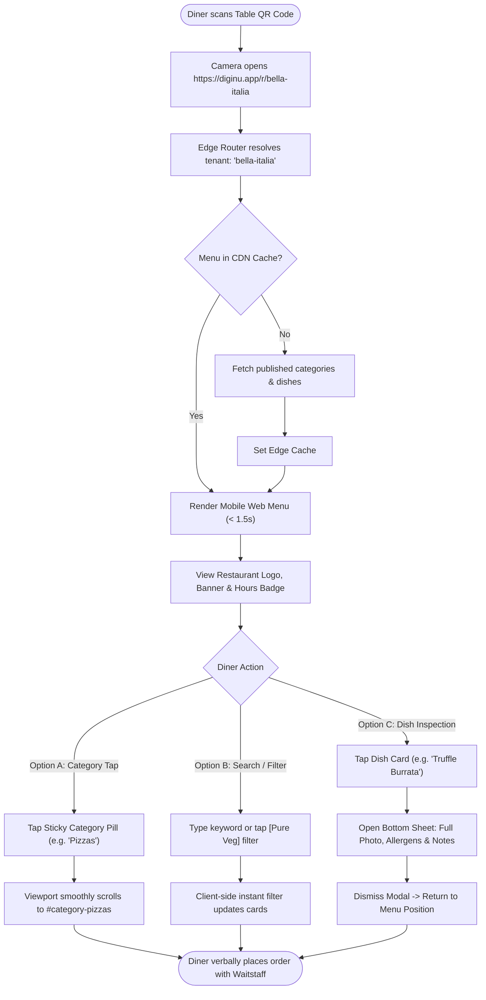
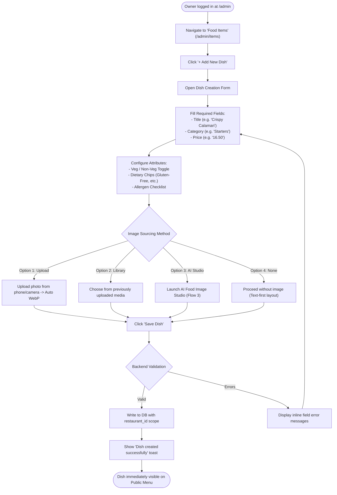
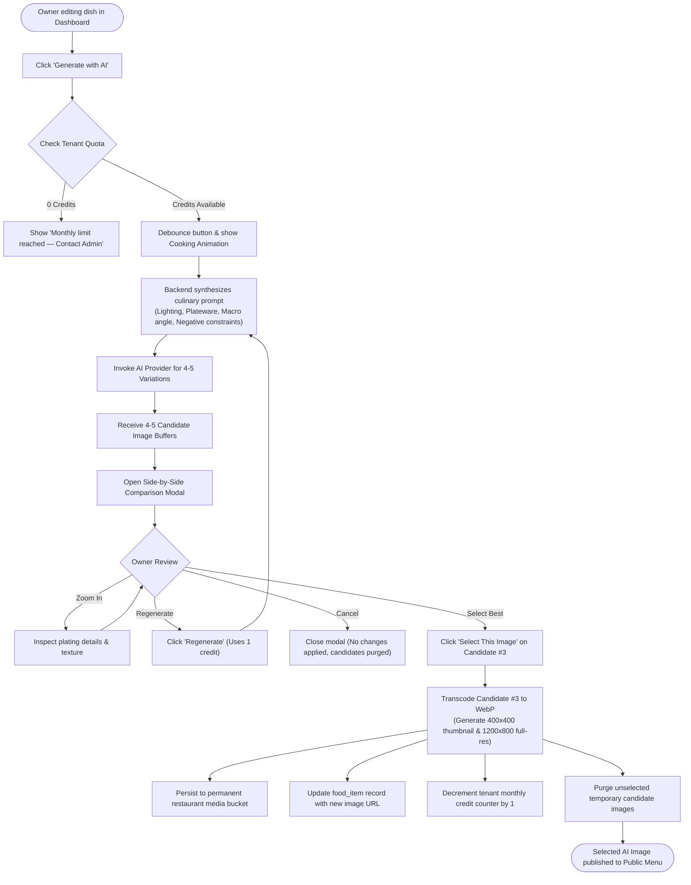
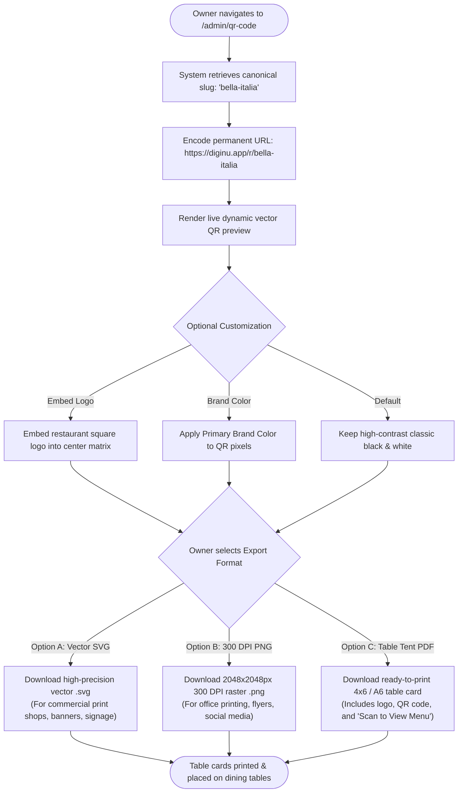

# Sitemap & User Flows — DigiNu

**Document Version:** 1.0  
**Phase:** 01 — Product Definition  
**Status:** DRAFT — REVIEW REQUIRED  
**Project:** DigiNu — Reusable QR-Based Digital Restaurant Menu Management System  

---

## 1. System Navigation Architecture & Sitemap

DigiNu features two completely segregated, purpose-built navigation trees:

```
+-----------------------------------------------------------------------------------+
|                                  DIGINU SITEMAP                                   |
+-----------------------------------------------------------------------------------+
| INTERFACE A: PUBLIC CUSTOMER MENU (Read-Only)                                     |
|                                                                                   |
| ├── /r/:restaurant-slug                    [Branded Menu View / Landing]          |
| │    ├── #category-:id                     [In-Page Sticky Category Jump Target]  |
| │    ├── ?search=:query                    [Filtered In-Page Search Results]      |
| │    └── (Drawer / Modal)                  [Food Item Detail, Allergens & Story]  |
| └── /r/:restaurant-slug/not-found          [Polite Inactive/Invalid Tenant Screen]|
|                                                                                   |
| INTERFACE B: PRIVATE OWNER DASHBOARD (Authenticated)                              |
|                                                                                   |
| ├── /admin/login                           [Owner Sign-In & Password Reset]       |
| ├── /admin                                 [Operational Dashboard & Quick Stats]  |
| ├── /admin/profile                         [Restaurant Branding, Logo & Hours]    |
| ├── /admin/categories                      [Category CRUD & Reordering List]      |
| ├── /admin/items                           [Food Item List, Filters & 86 Toggles] |
| │    ├── /admin/items/new                  [Create New Food Item Form]            |
| │    └── /admin/items/:id/edit             [Edit Item & Embedded AI Image Studio] |
| ├── /admin/media                           [Restaurant Image Asset Library]       |
| └── /admin/qr-code                         [QR Code Generator & Vector Export]    |
+-----------------------------------------------------------------------------------+
```

---

## 2. Core User Flows

### Flow 1: Customer Scans QR Code & Browses Menu

This flow represents 99% of user interactions across the platform. It must be blisteringly fast, require zero account creation, and have zero blockers.



---

### Flow 2: Owner Creates and Publishes a Food Item

Enables restaurant owners or floor managers to introduce a new dish with pricing, categorization, and dietary classifications.



---

### Flow 3: Owner Generates and Selects an AI Food Image

The flagship differentiator: Generating 4–5 hyper-realistic culinary options from dish details with a mandatory human approval step.



---

### Flow 4: Owner Generates and Downloads Print-Ready QR Codes

Enables owners to produce table displays that link permanently to their digital menu.


