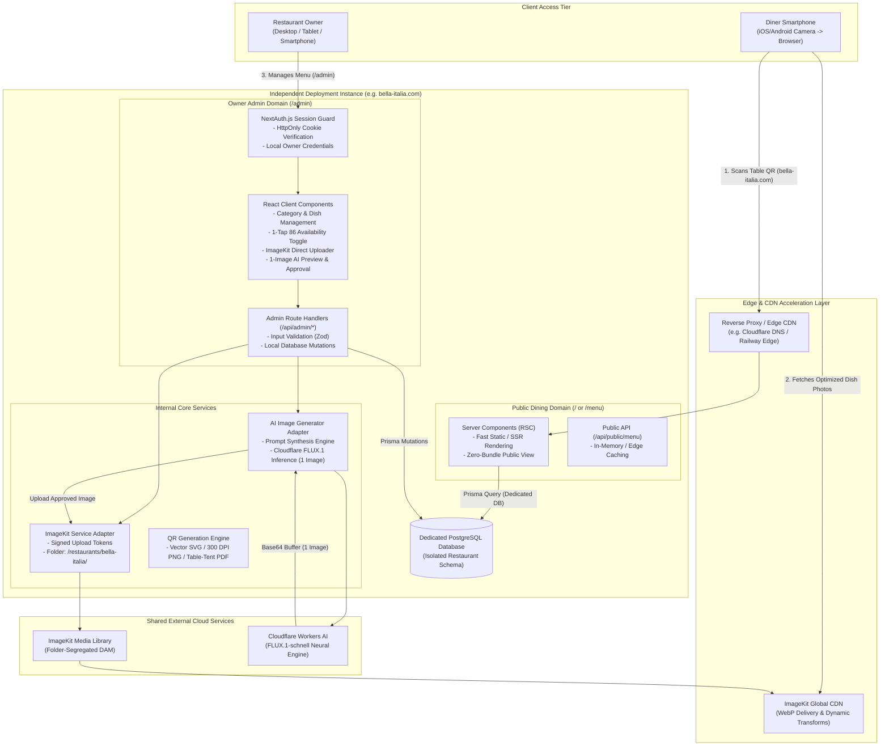
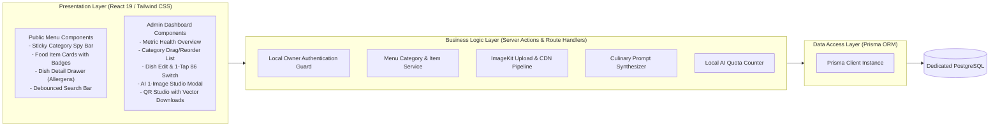
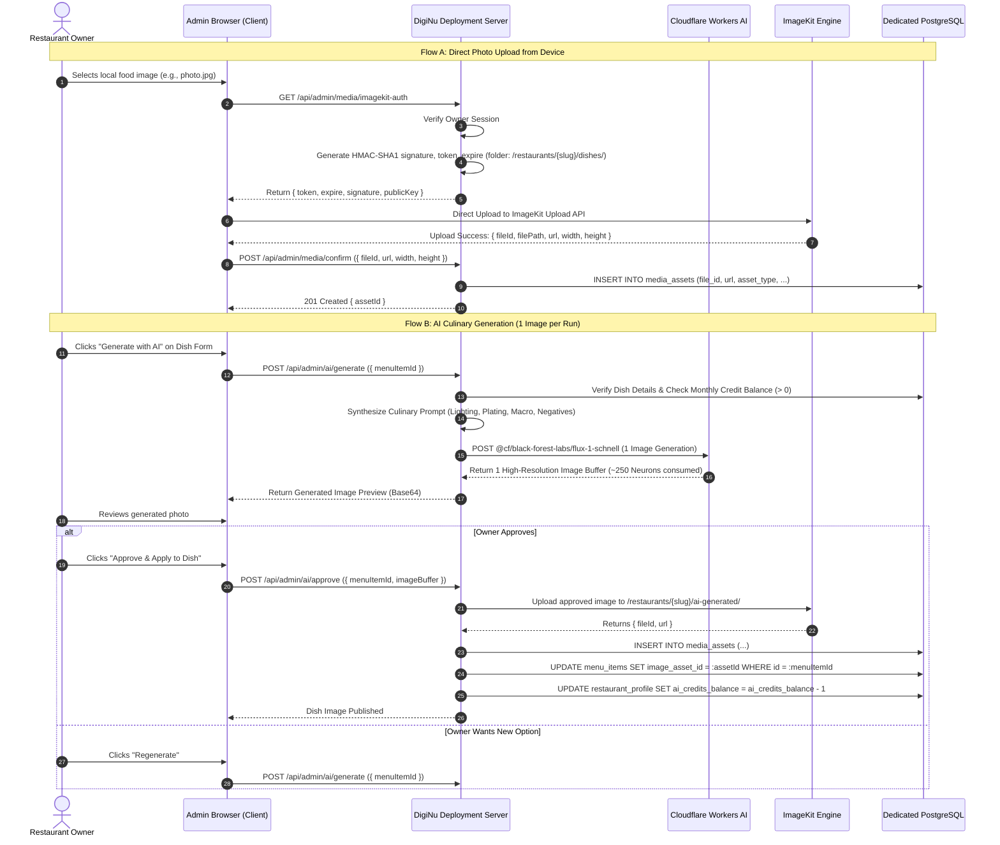
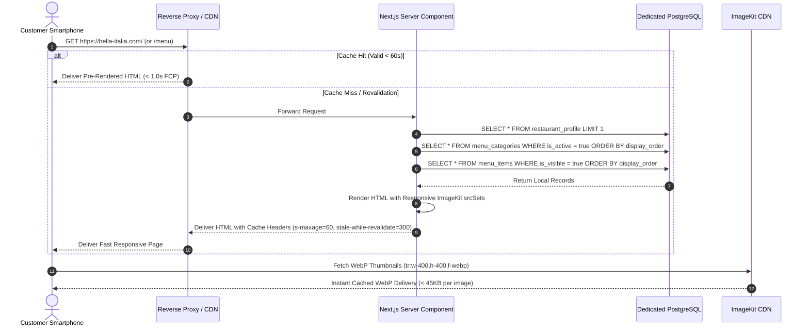

# System Architecture Document — DigiNu

**Document Version:** 2.0 (Independent Deployments Revision)  
**Phase:** 02 — Technical Architecture & Data Model  
**Status:** DRAFT — REVIEW REQUIRED  
**Project:** DigiNu — Reusable QR-Based Digital Restaurant Menu Platform  
**Architect:** Senior Solution Architect & Systems Engineering Team  

---

## 1. Architectural Style & Core Tenets

DigiNu is architected as an **Independent Deployable Full-Stack Monolith** built on **Next.js 15 (App Router, TypeScript)** backed by a **dedicated PostgreSQL database**, **Prisma ORM**, **ImageKit** media management, and **Cloudflare Workers AI** image generation.

### Core Architectural Tenets
1. **One Codebase, Independent Deployments:** A single reusable codebase is maintained. Each restaurant client receives its own independent application deployment, dedicated database, environment configuration, and custom domain.
2. **Absolute Physical Data Isolation:** Cross-tenant data leakage is completely eliminated at the infrastructure level. Every database contains only data belonging to that specific restaurant.
3. **Streamlined Application Logic:** No multi-tenant routing middleware, no `restaurant_id` foreign key clutter in tables, and no row-level security policies.
4. **Focused AI Culinary Workflow:** AI generates **1 high-resolution image per generation** (~250 Neurons), delivering ~3-second response times, reduced token consumption, and simple preview-and-approve UX.
5. **Third-Party Offloading:** Heavy media manipulation, responsive delivery, and format conversions are delegated to **ImageKit CDN**, while culinary photography generation is handled by **Cloudflare Workers AI**.

---

## 2. High-Level System Architecture Diagram (Independent Client Deployment)

---

## 3. Component Architecture

---

## 4. End-to-End Workflow Diagrams

### 4.1 ImageKit Direct Upload & 1-Image AI Generation Workflow

---

### 4.2 Public Menu Data-Fetching & Rendering Workflow

---

## 5. Technology Stack Summary (Per-Deployment)

| Component | Selected Technology | Deployment Role |
| :--- | :--- | :--- |
| **Application Framework** | **Next.js 15 (App Router, React 19, TypeScript)** | Unified frontend & backend monolith running in a dedicated container or serverless runtime per restaurant. |
| **Styling & Theming** | **Tailwind CSS + CSS Variables** | Compiled utility styling; restaurant-specific branding colors and theme presets applied via single-row database configuration. |
| **Database Engine** | **PostgreSQL (v15+)** | Dedicated isolated database per restaurant. Zero multi-tenant table pollution. |
| **ORM / Data Access** | **Prisma ORM** | Type-safe queries and automated migrations (`prisma migrate deploy`). |
| **Authentication** | **NextAuth.js v5 (Credentials)** | Secure local owner login with `HttpOnly` session cookies. |
| **Media Service** | **ImageKit.io** | Folder-segregated media storage (`/restaurants/{slug}/...`) with dynamic URL WebP transformations. |
| **AI Neural Engine** | **Cloudflare Workers AI (`flux-1-schnell`)** | High-speed generation of **1 image per run** (~250 Neurons). |
| **QR Code Engine** | **`qrcode` & `pdfkit`** | High-precision vector SVG, 300 DPI PNG, and table-tent PDF cards generated on-demand. |
| **Commercial Hosting** | **Railway / Render (PaaS) or Hetzner VPS (Coolify)** | Commercially compliant application and database hosting. |
