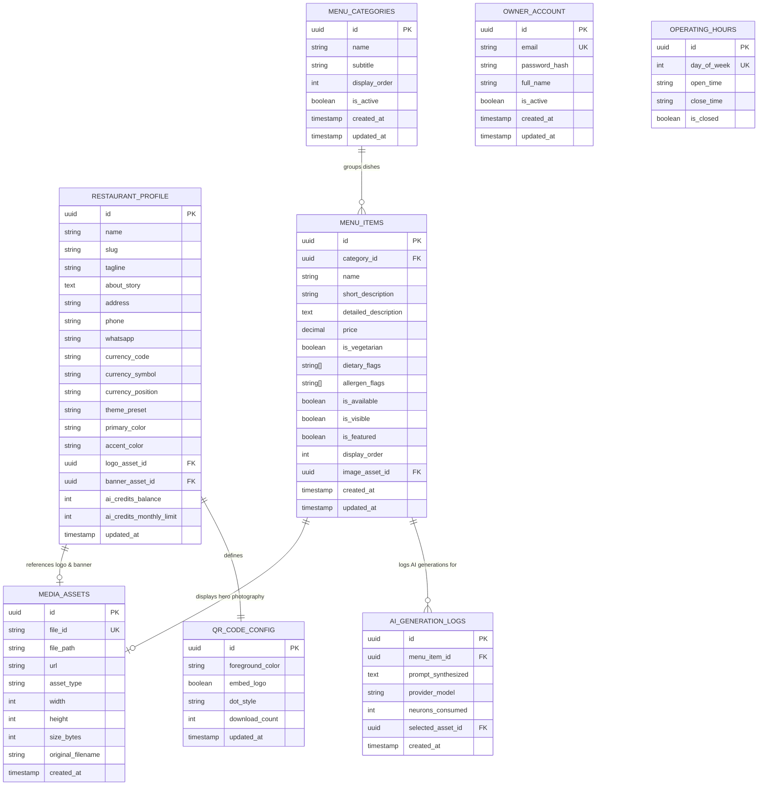

# Data Model & Entity-Relationship Diagram (ERD) — DigiNu

**Document Version:** 2.0 (Independent Deployments Revision)  
**Phase:** 02 — Technical Architecture & Data Model  
**Status:** DRAFT — REVIEW REQUIRED  
**Project:** DigiNu — Reusable QR-Based Digital Restaurant Menu Platform  

---

## 1. Single-Restaurant Database Architecture

Under the **Independent Deployments** model, each restaurant deployment connects to its own dedicated PostgreSQL database.

### Why This Simplifies the Data Model
* **Complete Elimination of `restaurant_id` Foreign Keys:** Because each database contains only one restaurant's records, every operational table (`menu_categories`, `menu_items`, `media_assets`, `operating_hours`, `qr_code_config`, `ai_generation_logs`) is completely free from redundant `restaurant_id` columns.
* **No Row-Level Security (RLS) Required:** Physical database separation guarantees that cross-tenant queries are impossible at the infrastructure layer.
* **Clean Singleton Configuration (`restaurant_profile`):** The former multi-tenant `restaurants` table is replaced with a single-row `restaurant_profile` entity containing venue metadata, theme presets, brand colors, currency, and AI credit balances.
* **Streamlined Indexes:** Indexes operate directly on sorting and visibility (`display_order`, `is_active`, `is_visible`), delivering sub-millisecond query execution without composite tenant keys.

---

## 2. Entity-Relationship Diagram (ERD)



---

## 3. Data Dictionary

### 3.1 Entity: `restaurant_profile` (Singleton Record)
Stores global restaurant identity, branding tokens, and operational parameters for this specific deployment.

| Field Name | Type | Constraints | Description |
| :--- | :--- | :--- | :--- |
| `id` | UUID | Primary Key, `gen_random_uuid()` | Single profile identifier. |
| `name` | VARCHAR(100) | NOT NULL | Commercial name of the restaurant. |
| `slug` | VARCHAR(60) | NOT NULL | URL identifier and ImageKit folder key. |
| `tagline` | VARCHAR(160) | NULL | Short cuisine description. |
| `about_story` | TEXT | NULL | Story text rendered in the info drawer. |
| `address` | VARCHAR(255) | NULL | Street address. |
| `phone` | VARCHAR(30) | NULL | Telephone contact for customer dialer. |
| `whatsapp` | VARCHAR(30) | NULL | WhatsApp contact. |
| `currency_code` | VARCHAR(3) | NOT NULL, DEFAULT `'USD'` | ISO currency code (USD, EUR, GBP, INR). |
| `currency_symbol` | VARCHAR(5) | NOT NULL, DEFAULT `'$'` | Symbol rendered on food cards (`$`, `€`, `£`, `₹`). |
| `currency_position` | VARCHAR(6) | NOT NULL, DEFAULT `'PREFIX'` | Either `'PREFIX'` (`$10`) or `'SUFFIX'` (`10 €`). |
| `theme_preset` | VARCHAR(30) | NOT NULL, DEFAULT `'clean-white'` | `'clean-white'`, `'warm-cream'`, `'midnight-charcoal'`. |
| `primary_color` | VARCHAR(7) | NOT NULL, DEFAULT `'#B91C1C'` | Primary brand accent color (Hex). |
| `accent_color` | VARCHAR(7) | NOT NULL, DEFAULT `'#F59E0B'` | Secondary brand accent color (Hex). |
| `logo_asset_id` | UUID | Foreign Key -> `media_assets(id)` | Restaurant square logo asset. |
| `banner_asset_id`| UUID | Foreign Key -> `media_assets(id)` | Wide cover banner asset. |
| `ai_credits_balance` | INT | NOT NULL, DEFAULT `30` | Remaining monthly AI image generation credits. |
| `ai_credits_monthly_limit` | INT | NOT NULL, DEFAULT `30` | Subscription monthly ceiling. |
| `updated_at` | TIMESTAMPTZ | NOT NULL, DEFAULT `now()` | Last modification timestamp. |

---

### 3.2 Entity: `owner_account`
Stores credentials for the restaurant owner / manager administering this deployment.

| Field Name | Type | Constraints | Description |
| :--- | :--- | :--- | :--- |
| `id` | UUID | Primary Key, `gen_random_uuid()` | Unique user identifier. |
| `email` | VARCHAR(255) | NOT NULL, UNIQUE | Login email address. |
| `password_hash` | VARCHAR(255) | NOT NULL | Salted bcrypt/Argon2 password hash. |
| `full_name` | VARCHAR(100) | NOT NULL | Owner's full name. |
| `is_active` | BOOLEAN | NOT NULL, DEFAULT `true` | Account active status. |
| `created_at` | TIMESTAMPTZ | NOT NULL, DEFAULT `now()` | Record creation timestamp. |
| `updated_at` | TIMESTAMPTZ | NOT NULL, DEFAULT `now()` | Last modification timestamp. |

---

### 3.3 Entity: `menu_categories`
Organizes dishes into logical sections (e.g., Starters, Mains, Pizzas, Desserts).

| Field Name | Type | Constraints | Description |
| :--- | :--- | :--- | :--- |
| `id` | UUID | Primary Key, `gen_random_uuid()` | Unique category identifier. |
| `name` | VARCHAR(60) | NOT NULL | Category name (e.g., "Handmade Pastas"). |
| `subtitle` | VARCHAR(160) | NULL | Optional description rendered below header. |
| `display_order` | INT | NOT NULL, DEFAULT `0` | Order sequence in category navigation bar. |
| `is_active` | BOOLEAN | NOT NULL, DEFAULT `true` | Visibility toggle (enables hiding seasonal sections). |
| `created_at` | TIMESTAMPTZ | NOT NULL, DEFAULT `now()` | Creation timestamp. |
| `updated_at` | TIMESTAMPTZ | NOT NULL, DEFAULT `now()` | Modification timestamp. |

---

### 3.4 Entity: `menu_items`
Individual food dishes displayed on the digital menu.

| Field Name | Type | Constraints | Description |
| :--- | :--- | :--- | :--- |
| `id` | UUID | Primary Key, `gen_random_uuid()` | Unique food item identifier. |
| `category_id` | UUID | NOT NULL, FK -> `menu_categories(id)` ON DELETE RESTRICT | Assigned category (deletion guarded). |
| `name` | VARCHAR(100) | NOT NULL | Culinary name of the dish. |
| `short_description`| VARCHAR(180)| NULL | 1-2 sentence overview on main card. |
| `detailed_description`| TEXT | NULL | Full ingredients & preparation in detail modal. |
| `price` | NUMERIC(8,2)| NOT NULL, CHECK (`price >= 0`) | Dish price (supports decimals). |
| `is_vegetarian` | BOOLEAN | NOT NULL, DEFAULT `false` | Veg (green dot) vs. Non-Veg (brown dot). |
| `dietary_flags` | TEXT[] | NOT NULL, DEFAULT `{}` | Array: `['VEGAN', 'GLUTEN_FREE', 'HALAL', 'SPICY']`. |
| `allergen_flags` | TEXT[] | NOT NULL, DEFAULT `{}` | Array: `['DAIRY', 'NUTS', 'EGGS', 'SHELLFISH']`. |
| `is_available` | BOOLEAN | NOT NULL, DEFAULT `true` | Real-time availability (`false` = `Sold Out Today`). |
| `is_visible` | BOOLEAN | NOT NULL, DEFAULT `true` | Visibility toggle (`false` = draft hidden from public). |
| `is_featured` | BOOLEAN | NOT NULL, DEFAULT `false` | Highlight badge (`Chef's Special`). |
| `display_order` | INT | NOT NULL, DEFAULT `0` | Sort ranking within category. |
| `image_asset_id`| UUID | NULL, FK -> `media_assets(id)` ON DELETE SET NULL | Hero food photography reference. |
| `created_at` | TIMESTAMPTZ | NOT NULL, DEFAULT `now()` | Creation timestamp. |
| `updated_at` | TIMESTAMPTZ | NOT NULL, DEFAULT `now()` | Modification timestamp. |

---

### 3.5 Entity: `media_assets`
Stores ImageKit metadata for all restaurant media (logos, banners, dishes).

| Field Name | Type | Constraints | Description |
| :--- | :--- | :--- | :--- |
| `id` | UUID | Primary Key, `gen_random_uuid()` | Unique asset identifier. |
| `file_id` | VARCHAR(100) | NOT NULL, UNIQUE | ImageKit unique file ID. |
| `file_path` | VARCHAR(255) | NOT NULL | Path in ImageKit (e.g. `/restaurants/slug/dishes/calamari.jpg`). |
| `url` | VARCHAR(500) | NOT NULL | Canonical ImageKit delivery URL. |
| `asset_type` | VARCHAR(30) | NOT NULL | `'LOGO'`, `'BANNER'`, `'FOOD_UPLOAD'`, `'AI_GENERATED'`. |
| `width` | INT | NOT NULL | Original image width. |
| `height` | INT | NOT NULL | Original image height. |
| `size_bytes` | INT | NOT NULL | Image file size in bytes. |
| `original_filename`| VARCHAR(255)| NOT NULL | Name of the source file. |
| `created_at` | TIMESTAMPTZ | NOT NULL, DEFAULT `now()` | Creation timestamp. |

---

### 3.6 Entity: `operating_hours`
7-day schedule for the restaurant.

| Field Name | Type | Constraints | Description |
| :--- | :--- | :--- | :--- |
| `id` | UUID | Primary Key, `gen_random_uuid()` | Unique hour record. |
| `day_of_week` | SMALLINT | NOT NULL, UNIQUE, CHECK (`day_of_week BETWEEN 0 AND 6`) | 0 = Sunday, 1 = Monday, ..., 6 = Saturday. |
| `open_time` | VARCHAR(5) | NOT NULL, DEFAULT `'11:00'` | 24-hr format (e.g. `'11:30'`). |
| `close_time` | VARCHAR(5) | NOT NULL, DEFAULT `'22:00'` | 24-hr format (e.g. `'23:00'`). |
| `is_closed` | BOOLEAN | NOT NULL, DEFAULT `false` | Day closed toggle. |

---

### 3.7 Entity: `qr_code_config` (Singleton Record)
QR generation and styling preferences for this restaurant.

| Field Name | Type | Constraints | Description |
| :--- | :--- | :--- | :--- |
| `id` | UUID | Primary Key, `gen_random_uuid()` | Unique configuration record. |
| `foreground_color`| VARCHAR(7) | NOT NULL, DEFAULT `'#000000'` | QR matrix color code. |
| `embed_logo` | BOOLEAN | NOT NULL, DEFAULT `true` | Embed center logo toggle. |
| `dot_style` | VARCHAR(20) | NOT NULL, DEFAULT `'rounded'` | `'rounded'`, `'dots'`, `'square'`. |
| `download_count` | INT | NOT NULL, DEFAULT `0` | Download tracking counter. |
| `updated_at` | TIMESTAMPTZ | NOT NULL, DEFAULT `now()` | Last modification timestamp. |

---

### 3.8 Entity: `ai_generation_logs`
Audit history of AI image generation jobs for this restaurant.

| Field Name | Type | Constraints | Description |
| :--- | :--- | :--- | :--- |
| `id` | UUID | Primary Key, `gen_random_uuid()` | Unique audit log ID. |
| `menu_item_id` | UUID | NOT NULL, FK -> `menu_items(id)` ON DELETE CASCADE | Dish for which image was generated. |
| `prompt_synthesized`| TEXT | NOT NULL | Exact culinary prompt sent to neural model. |
| `provider_model` | VARCHAR(60) | NOT NULL | Model identifier (`flux-1-schnell`). |
| `neurons_consumed` | INT | NOT NULL, DEFAULT `250` | Neurons consumed (1 image = ~250). |
| `selected_asset_id`| UUID | NULL, FK -> `media_assets(id)` | Approved asset reference. |
| `created_at` | TIMESTAMPTZ | NOT NULL, DEFAULT `now()` | Generation timestamp. |

---

## 4. Database Indexing Strategy (Optimized for Single Deployment)

```sql
-- 1. Public Menu Active Categories Query
CREATE INDEX idx_categories_display ON menu_categories(is_active, display_order);

-- 2. Public Menu Visible Food Items Query
CREATE INDEX idx_menu_items_display ON menu_items(category_id, is_visible, display_order);

-- 3. Dietary & Allergen Search (GIN Array Indexes)
CREATE INDEX idx_menu_items_dietary ON menu_items USING GIN (dietary_flags);
CREATE INDEX idx_menu_items_allergens ON menu_items USING GIN (allergen_flags);

-- 4. Media Asset Lookup
CREATE INDEX idx_media_assets_type ON media_assets(asset_type);

-- 5. AI Generation Audit History
CREATE INDEX idx_ai_logs_created ON ai_generation_logs(created_at);
```

---

## 5. Public Query Boundary & Data Isolation Rules

Because the database contains only data for this restaurant:
1. **Simplified Public Queries:** Public read queries execute simple filters without tenant parameters:
   ```sql
   SELECT * FROM menu_items WHERE is_visible = true ORDER BY display_order;
   ```
2. **Zero Cross-Tenant Leakage Risk:** There is no chance of accidentally returning another client's dishes, drafts, or financial data because no other restaurant's records exist in this database.
3. **Data Sanitization:** Public API route handlers explicitly filter out owner credentials, password hashes, and draft items from JSON responses.
