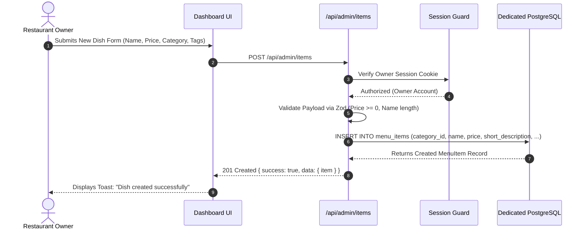
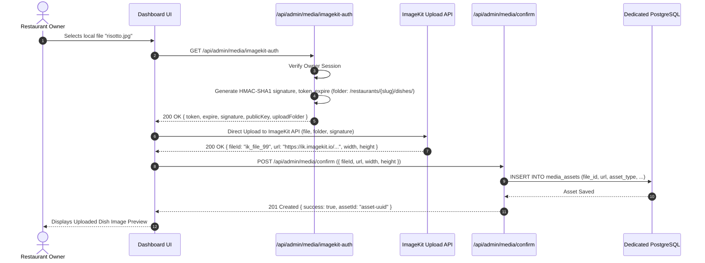
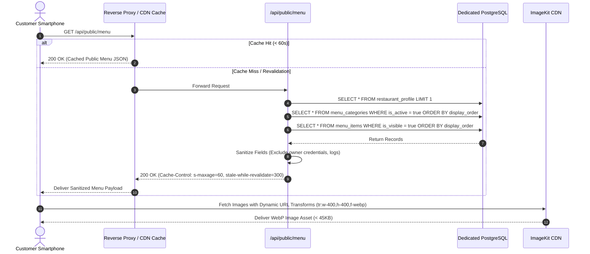

# API & Integration Contracts — DigiNu

**Document Version:** 2.0 (Independent Deployments Revision)  
**Phase:** 02 — Technical Architecture & Data Model  
**Status:** DRAFT — REVIEW REQUIRED  
**Project:** DigiNu — Reusable QR-Based Digital Restaurant Menu Platform  

---

## 1. API Architecture & Standards

DigiNu provides a standardized RESTful API surface optimized for an independent single-restaurant deployment:

* **Public vs. Protected Separation:** Public dining endpoints (`/api/public/*`) are read-only and edge-cached. Administrative mutation endpoints (`/api/admin/*`) require an authenticated owner session.
* **Streamlined Scoping:** Because each deployment has its own dedicated database, endpoints interact directly with local tables without needing `restaurant_id` route parameters or multi-tenant filtering.
* **Input Validation:** All payloads are validated using **Zod** schemas. Malformed inputs return structured `422 Unprocessable Content` responses detailing field-level violations.
* **Uniform Response Envelope:**
  ```json
  {
    "success": true,
    "data": { ... },
    "error": null
  }
  ```

---

## 2. Sequence & Interaction Diagrams

### 2.1 Owner Creating a Menu Item



---

### 2.2 Owner Uploading an Image via ImageKit Direct Flow



---

### 2.3 Owner Generating AI Image (1-Image Workflow) & Selecting

```mermaid
sequenceDiagram
    autonumber
    actor Owner as Restaurant Owner
    participant Web as Dashboard UI
    participant API as /api/admin/ai/generate
    participant ApprAPI as /api/admin/ai/approve
    participant CF_AI as Cloudflare Workers AI
    participant IK as ImageKit Engine
    participant DB as Dedicated PostgreSQL

    Owner->>Web: Clicks "Generate with AI" on Dish Edit Form
    Web->>API: POST /api/admin/ai/generate ({ menuItemId })
    API->>DB: Query Dish Details & Verify AI Credit Balance (> 0)
    API->>API: Synthesize Culinary Prompt (Lighting, Plateware, Macro, Negatives)
    API->>CF_AI: POST @cf/black-forest-labs/flux-1-schnell (1 Image Generation)
    CF_AI-->>API: Returns 1 High-Resolution Image Buffer (~250 Neurons consumed)
    API-->>Web: 200 OK { previewUrl: "data:image/jpeg;base64,...", promptUsed }
    Web-->>Owner: Displays Generated Photo Preview in Modal
    alt Owner Approves Image
        Owner->>Web: Clicks "Approve & Apply to Dish"
        Web->>ApprAPI: POST /api/admin/ai/approve ({ menuItemId, imageBufferBase64 })
        ApprAPI->>IK: Upload approved image to /restaurants/{slug}/ai-generated/
        IK-->>ApprAPI: Returns { fileId: "ik_ai_77", url: "https://ik.imagekit.io/..." }
        ApprAPI->>DB: INSERT INTO media_assets (...)
        ApprAPI->>DB: UPDATE menu_items SET image_asset_id = :assetId WHERE id = :menuItemId
        ApprAPI->>DB: UPDATE restaurant_profile SET ai_credits_balance = ai_credits_balance - 1
        ApprAPI->>DB: INSERT INTO ai_generation_logs (...)
        ApprAPI-->>Web: 200 OK { success: true, imageAsset: { url } }
        Web-->>Owner: Selected Image Applied & Credit Deducted
    else Owner Wants New Variation
        Owner->>Web: Clicks "Regenerate"
        Web->>API: POST /api/admin/ai/generate ({ menuItemId })
    end
```

---

### 2.4 Customer Loading Public Menu



---

## 3. Public API Endpoint Contracts (Read-Only)

### 3.1 `GET /api/public/menu`
* **Purpose:** Retrieves the complete, sanitized digital menu for this restaurant deployment.
* **Authentication:** None (Public / Anonymous).
* **Caching:** Edge-cached with `Cache-Control: public, s-maxage=60, stale-while-revalidate=300`.

#### Success Response (`200 OK`)
```json
{
  "success": true,
  "data": {
    "restaurant": {
      "name": "Trattoria Da Luigi",
      "slug": "trattoria-luigi",
      "tagline": "Authentic Tuscan Flavors",
      "aboutStory": "Handmade pasta crafted fresh daily using generational Italian recipes.",
      "address": "142 Via Roma, Firenze",
      "phone": "+15550192831",
      "whatsapp": "+15550192831",
      "currency": {
        "code": "USD",
        "symbol": "$",
        "position": "PREFIX"
      },
      "theme": {
        "preset": "warm-cream",
        "primaryColor": "#B91C1C",
        "accentColor": "#F59E0B"
      },
      "logoUrl": "https://ik.imagekit.io/diginu/restaurants/trattoria-luigi/branding/logo.png?tr=w-200,h-200,f-webp",
      "bannerUrl": "https://ik.imagekit.io/diginu/restaurants/trattoria-luigi/branding/banner.jpg?tr=w-1200,h-400,f-webp",
      "operatingHours": [
        { "day": 1, "open": "11:30", "close": "22:00", "isClosed": false }
      ]
    },
    "categories": [
      {
        "id": "cat-uuid-01",
        "name": "Starters & Antipasti",
        "subtitle": "Perfect for sharing",
        "displayOrder": 1,
        "items": [
          {
            "id": "item-uuid-101",
            "name": "Truffle Burrata Bruschetta",
            "shortDescription": "Toasted ciabatta, creamy burrata, fresh shaved black truffle.",
            "detailedDescription": "Slow-fermented artisan sourdough topped with Puglia burrata, organic cherry tomatoes, and Umbrian black summer truffle oil.",
            "price": "14.50",
            "isVegetarian": true,
            "dietaryFlags": ["GLUTEN_FREE_OPT"],
            "allergenFlags": ["DAIRY", "GLUTEN"],
            "isAvailable": true,
            "isFeatured": true,
            "imageUrl": "https://ik.imagekit.io/diginu/restaurants/trattoria-luigi/dishes/burrata.jpg?tr=w-400,h-400,f-webp"
          },
          {
            "id": "item-uuid-102",
            "name": "Prosciutto e Melone",
            "shortDescription": "Aged 24mo Parma ham with sweet cantaloupe.",
            "detailedDescription": "Thinly shaved Prosciutto di Parma paired with ripe Tuscan melon.",
            "price": "15.00",
            "isVegetarian": false,
            "dietaryFlags": ["DAIRY_FREE"],
            "allergenFlags": [],
            "isAvailable": false,
            "isFeatured": false,
            "imageUrl": "https://ik.imagekit.io/diginu/restaurants/trattoria-luigi/dishes/prosciutto.jpg?tr=w-400,h-400,f-webp"
          }
        ]
      }
    ]
  },
  "error": null
}
```

---

## 4. Owner Administrative API Endpoints (Authenticated)

All `/api/admin/*` endpoints require a valid session cookie. Requests without authentication return `401 Unauthorized`.

### 4.1 Authentication Endpoints

#### `POST /api/auth/login`
* **Purpose:** Authenticate owner with email and password; set secure session cookie.
* **Payload:**
  ```json
  {
    "email": "owner@trattoria.com",
    "password": "CorrectHorseBatteryStaple1!"
  }
  ```
* **Success (`200 OK`):** Sets `Set-Cookie: __Secure-next-auth.session-token=...; HttpOnly; SameSite=Lax; Path=/`.
* **Rate Limit:** 5 attempts per 15 minutes per IP. Exceeding returns `429 Too Many Requests`.

---

### 4.2 Category Management Endpoints

#### `POST /api/admin/categories`
* **Purpose:** Create a new menu category.
* **Request Body:**
  ```json
  {
    "name": "Handmade Pastas",
    "subtitle": "Fresh daily 00 flour pasta",
    "displayOrder": 2
  }
  ```
* **Validation (Zod):** `name`: string, min 2, max 60 chars. `subtitle`: optional, max 160 chars.
* **Response (`201 Created`):** Returns the persisted category with generated `id`.

#### `PUT /api/admin/categories/reorder`
* **Purpose:** Persist the display sequence of categories on the public menu.
* **Request Body:**
  ```json
  {
    "orderedIds": ["cat-uuid-01", "cat-uuid-03", "cat-uuid-02"]
  }
  ```
* **Response (`200 OK`):** `{ "success": true, "message": "Category sequence updated." }`

#### `DELETE /api/admin/categories/:id`
* **Purpose:** Delete an empty category.
* **Safeguard:** If category contains >= 1 food items, deletion returns `409 Conflict`:
  ```json
  {
    "success": false,
    "data": null,
    "error": {
      "code": "CATEGORY_NOT_EMPTY",
      "message": "Cannot delete category containing dishes. Reassign or delete these items first."
    }
  }
  ```

---

### 4.3 Food Item Management Endpoints

#### `POST /api/admin/items`
* **Purpose:** Create a new food item.
* **Request Body:**
  ```json
  {
    "categoryId": "cat-uuid-01",
    "name": "Crispy Calamari Fritti",
    "shortDescription": "Flash-fried squid with smoked garlic aioli.",
    "detailedDescription": "Monterey Bay squid dusted in semolina flour, served with charred Sicilian lemon.",
    "price": 16.50,
    "isVegetarian": false,
    "dietaryFlags": ["DAIRY_FREE"],
    "allergenFlags": ["MOLLUSCS", "EGGS", "GLUTEN"],
    "isAvailable": true,
    "isFeatured": true,
    "imageAssetId": "asset-uuid-88"
  }
  ```
* **Response (`201 Created`):** Returns complete created `menu_item` record.

#### `PATCH /api/admin/items/:id/availability`
* **Purpose:** 1-tap availability toggle (86ing a dish) during service.
* **Request Body:**
  ```json
  {
    "isAvailable": false
  }
  ```
* **Response (`200 OK`):** `{ "success": true, "data": { "id": "item-uuid-101", "isAvailable": false } }`

---

### 4.4 ImageKit Media Management Endpoints

#### `GET /api/admin/media/imagekit-auth`
* **Purpose:** Generates secure HMAC-SHA1 upload authentication parameters for direct client uploads.
* **Authentication:** Owner session required.
* **Response (`200 OK`):**
  ```json
  {
    "success": true,
    "data": {
      "token": "d748f2a1-b84e-4f7e-913b-18a679234b11",
      "expire": 1731000000,
      "signature": "4a7b5d2e3f1c8a9b0c2d3e4f5a6b7c8d9e0f1a2b",
      "publicKey": "public_ik_test_12345",
      "uploadFolder": "/restaurants/trattoria-luigi/dishes"
    }
  }
  ```

#### `POST /api/admin/media/confirm`
* **Purpose:** Confirms successful client upload to ImageKit and records metadata in `media_assets`.
* **Request Body:**
  ```json
  {
    "fileId": "ik_file_99",
    "filePath": "/restaurants/trattoria-luigi/dishes/calamari_abc.jpg",
    "url": "https://ik.imagekit.io/diginu/restaurants/trattoria-luigi/dishes/calamari_abc.jpg",
    "assetType": "FOOD_UPLOAD",
    "width": 1200,
    "height": 900,
    "sizeBytes": 345000,
    "originalFilename": "calamari.jpg"
  }
  ```
* **Response (`201 Created`):** Returns saved `media_assets` entity.

---

### 4.5 AI Image Generation Endpoints (1-Image Workflow)

#### `POST /api/admin/ai/generate`
* **Purpose:** Triggers prompt synthesis and calls Cloudflare Workers AI for **1 image**.
* **Request Body:**
  ```json
  {
    "menuItemId": "item-uuid-101"
  }
  ```
* **Processing:**
  1. Verifies owner session and checks that `restaurant_profile.ai_credits_balance >= 1`.
  2. Synthesizes culinary prompt.
  3. Executes single generation call against Cloudflare Workers AI (`@cf/black-forest-labs/flux-1-schnell`).
* **Response (`200 OK`):**
  ```json
  {
    "success": true,
    "data": {
      "menuItemId": "item-uuid-101",
      "promptUsed": "Commercial food photography of Crispy Calamari Fritti, garnished with charred lemon...",
      "creditsRemaining": 29,
      "previewUrl": "data:image/jpeg;base64,/9j/4AAQ..."
    }
  }
  ```

#### `POST /api/admin/ai/approve`
* **Purpose:** Persists approved image buffer to ImageKit, attaches to dish, logs run, and decrements credit.
* **Request Body:**
  ```json
  {
    "menuItemId": "item-uuid-101",
    "imageBufferBase64": "/9j/4AAQSkZJRg..."
  }
  ```
* **Response (`200 OK`):**
  ```json
  {
    "success": true,
    "data": {
      "menuItemId": "item-uuid-101",
      "imageAssetId": "asset-uuid-202",
      "imageUrl": "https://ik.imagekit.io/diginu/restaurants/trattoria-luigi/ai-generated/calamari.webp"
    }
  }
  ```

---

### 4.6 QR Code Studio Endpoints

#### `GET /api/admin/qr-code/download`
* **Purpose:** Generates and streams print-ready table QR assets.
* **Query Parameters:**
  - `format`: `svg` | `png` | `pdf`
  - `embedLogo`: `true` | `false`
  - `color`: Hex color (e.g. `%23B91C1C`)
* **Response:**
  - For `svg`: `Content-Type: image/svg+xml`
  - For `png`: `Content-Type: image/png` (300 DPI 2048x2048)
  - For `pdf`: `Content-Type: application/pdf` (A6 / 4x6 Table-Tent Card)
