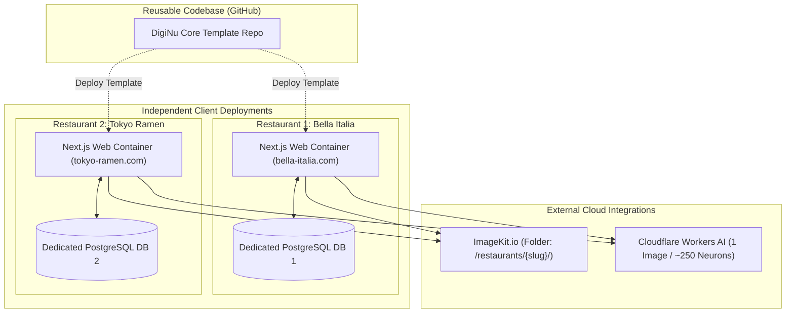

# Security & Deployment Architecture — DigiNu

**Document Version:** 2.0 (Independent Deployments Revision)  
**Phase:** 02 — Technical Architecture & Data Model  
**Status:** DRAFT — REVIEW REQUIRED  
**Project:** DigiNu — Reusable QR-Based Digital Restaurant Menu Platform  

---

## 1. Security Architecture & Threat Model

By adopting **Independent Deployments**, DigiNu eliminates the single greatest security vulnerability in SaaS: cross-tenant data leakage. Because each restaurant deployment has its own dedicated database and container, one client's data is physically isolated from another.

### 1.1 Threat Model Matrix

| Threat ID | Threat Description | Possible Impact | Preventive Architecture Measure | Priority |
| :--- | :--- | :--- | :--- | :---: |
| **TH-01** | **Malicious File Upload**<br>(Executable disguised as image) | Server compromise or CDN script execution. | Client & server magic number MIME sniffing; uploads route directly to ImageKit with binary execution disabled. | **CRITICAL** |
| **TH-02** | **Owner Credential Brute-Force**<br>(Password guessing on `/admin/login`) | Account takeover of restaurant dashboard. | Strict IP-based rate limiting (5 failed attempts per 15 min); bcrypt password hashing with salt rounds >= 12. | **HIGH** |
| **TH-03** | **ImageKit Secret Key Exposure** | Unauthorized file deletion or asset manipulation. | ImageKit Private Key stored strictly in server-side environment variables; client receives only short-lived HMAC signatures. | **CRITICAL** |
| **TH-04** | **AI API Quota Exhaustion / Denial of Wallet** | Runaway cloud billing for the freelancer. | Per-restaurant monthly generation limits (`ai_credits_balance`); client debouncing & server mutex locks. | **HIGH** |
| **TH-05** | **Public Menu DDoS / Scraping** | Database connection exhaustion during peak hours. | Reverse proxy / Edge CDN caching (`s-maxage=60, stale-while-revalidate=300`); rate limits (120 req/min/IP). | **HIGH** |
| **TH-06** | **Diner Privacy Intrusion** | Regulatory non-compliance (GDPR/CCPA). | 100% anonymous diner access; zero tracking cookies, zero analytics cookies, no PII collected from diners. | **MEDIUM** |

---

## 2. Authentication & Session Security

* **Framework:** NextAuth.js (Auth.js v5) configured with Credentials Provider.
* **Token Integrity:** Uses encrypted JWT session tokens or secure database sessions stored in `HttpOnly`, `SameSite=Lax`, `Secure` cookies.
* **Instance Scoping:** The session grants access exclusively to the local deployment's administrative endpoints (`/admin/*`).
* **Session Lifetime:** Idle session expiration set to 14 days, absolute session expiration at 30 days.

---

## 3. ImageKit & AI Credential Protection

### 3.1 ImageKit Upload Security Flow
1. **Private API Key Isolation:** `IMAGEKIT_PRIVATE_KEY` is strictly evaluated in server context and never exposed via `NEXT_PUBLIC_` variables.
2. **HMAC-SHA1 Signature Generation:** When the owner uploads an image, the server generates:
   - `token`: Random UUID string.
   - `expire`: Unix timestamp valid for 30 minutes.
   - `signature`: HMAC-SHA1 hash of `token + expire` using the private key.
3. **Folder Scoping:** Uploads are strictly bound to `/restaurants/{slug}/dishes/`.

### 3.2 Cloudflare Workers AI Token Isolation
* `CLOUDFLARE_API_TOKEN` and `CLOUDFLARE_ACCOUNT_ID` reside exclusively in server secrets.
* All AI prompt formulation and model inference execution happen within server-side route handlers (`/api/admin/ai/generate`). Raw image buffers are temporarily held in server memory before being transferred to ImageKit.

---

## 4. Input Sanitization & Content Security Policy (CSP)

* **Zod Schema Validation:** Every administrative route enforces strict Zod parsing:
  - Dish names: Stripped of control characters and HTML tags.
  - Price: Validated as positive numerical decimal.
  - URLs: Verified against safe protocols (`https:` only).
* **Content Security Policy Headers:**
  ```http
  Content-Security-Policy: default-src 'self'; img-src 'self' data: https://ik.imagekit.io; style-src 'self' 'unsafe-inline'; font-src 'self'; script-src 'self'; frame-ancestors 'none';
  ```
* **Clickjacking Protection:** `X-Frame-Options: DENY` applied to all administrative routes.

---

## 5. Deployment Architecture & Commercial Hosting Compliance

> [!WARNING]
> **Vercel Commercial Terms:** Vercel Hobby tier is restricted to non-commercial personal projects. Deploying paid client menus on Vercel requires a **Vercel Pro account ($20/month per user)**. 

To keep commercial infrastructure costs low, reliable, and compliant, two practical hosting paths are recommended:

### Option A: Managed PaaS (Railway / Render) `[RECOMMENDATION FOR EASE]`
* **Structure:** Each restaurant is provisioned as an independent project or service on Railway/Render.
* **Resources per Restaurant:**
  - 1 Next.js Web Service ($5/month).
  - 1 Managed PostgreSQL Database ($5/month).
* **Cost:** ~$10/month per restaurant. Automated Git deployments, built-in SSL, and custom domain mapping.

### Option B: Self-Managed VPS with Coolify `[RECOMMENDATION FOR MAXIMUM MARGIN]`
* **Structure:** A single high-performance Linux VPS (e.g., Hetzner CPX31, 4 vCPUs, 16 GB RAM at ~$18/month) running **Coolify** (open-source self-hosted PaaS).
* **Capacity:** Can host **10 to 20 independent restaurant containers and databases** on a single VPS.
* **Cost:** ~$18–$25/month total for up to 15 restaurants (averages ~$1.50/month per client).



---

## 6. Backup, Recovery & Monitoring

* **Automated Daily Database Backups:**
  - Automated logical `pg_dump` snapshots executed daily via cron and stored in secure S3/R2 cold storage.
  - 7-day retention policy.
* **Application Monitoring:**
  - **Healthcheck Route:** `GET /api/health` probes local database connectivity and returns `200 OK { status: "healthy" }`.
  - **Sentry Error Tracking (Optional):** Captures unhandled client or server exceptions.
