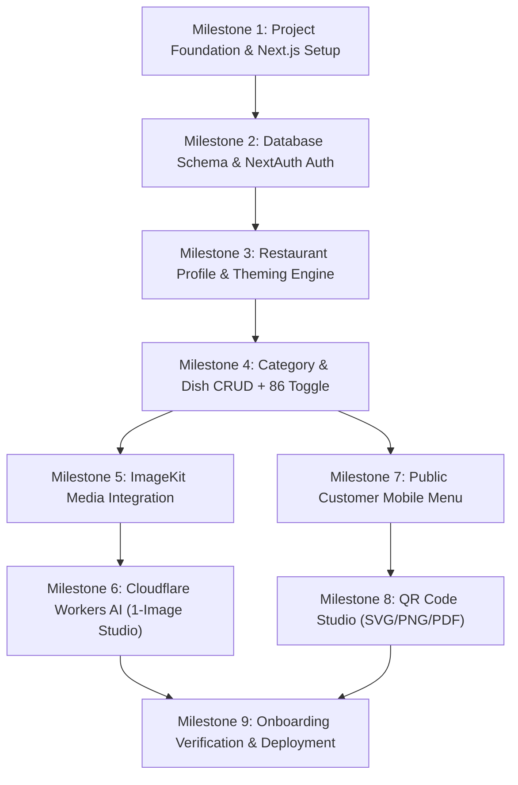

# Implementation Roadmap & Traceability Matrix — DigiNu

**Document Version:** 2.0 (Independent Deployments Revision)  
**Phase:** 02 — Technical Architecture & Data Model  
**Status:** DRAFT — REVIEW REQUIRED  
**Project:** DigiNu — Reusable QR-Based Digital Restaurant Menu Platform  

---

## 1. Implementation Phasing Strategy

Future development is sequenced into 9 practical, incremental milestones designed for a solo developer to achieve continuous, testable progress:

### Detailed Milestone Breakdown

* **Milestone 1: Reusable Project Foundation & Tooling (Sprint 1)**
  - Initialize Next.js 15 (App Router, TypeScript, Tailwind CSS, ESLint).
  - Configure folder layout, path aliases (`@/*`), and global CSS variable theme tokens.
* **Milestone 2: Dedicated Database Schema & Authentication (Sprint 1)**
  - Configure Prisma ORM with PostgreSQL.
  - Implement 8 single-restaurant models (`restaurant_profile`, `owner_account`, `menu_categories`, `menu_items`, `media_assets`, `operating_hours`, `qr_code_config`, `ai_generation_logs`).
  - Set up NextAuth.js v5 credentials provider, password hashing (bcrypt), and session guard.
  - Implement repeatable seed script (`prisma/seed.ts`).
* **Milestone 3: Restaurant Profile & Theming Engine (Sprint 2)**
  - Admin profile management form (`/admin/profile`).
  - Brand color pickers, theme preset selector (`clean-white`, `warm-cream`, `midnight-charcoal`), currency selector, and 7-day operating hours editor.
* **Milestone 4: Category & Food Item CRUD (Sprint 2)**
  - Category list with drag-and-drop or arrow reordering (`/admin/categories`).
  - Dish creation/edit form (`/admin/items/new`, `/admin/items/:id/edit`).
  - Real-time 1-tap `Available` vs. `Sold Out (86)` toggle on dashboard list.
* **Milestone 5: ImageKit Media Integration (Sprint 3)**
  - Implement `/api/admin/media/imagekit-auth` returning HMAC-SHA1 signature scoped to `/restaurants/{slug}/`.
  - Client-side drag-and-drop direct upload component to ImageKit CDN.
  - Implement `/api/admin/media/confirm` to persist metadata in `media_assets`.
* **Milestone 6: Cloudflare Workers AI Food Studio — 1-Image Workflow (Sprint 3)**
  - Culinary prompt synthesis engine (plating, lighting, negative constraints).
  - Cloudflare Workers AI adapter calling `@cf/black-forest-labs/flux-1-schnell` for **1 image**.
  - Interactive preview modal with zoom inspection and 1-tap approval/regeneration.
  - Approval handler uploading selected image to ImageKit and attaching to dish.
* **Milestone 7: Public Customer Mobile Menu (Sprint 4)**
  - Public menu route `/` and `/menu` with Edge CDN caching headers.
  - Sticky category scroll-spy navigation bar.
  - Food cards with WebP responsive srcSets, Veg/Non-Veg indicators, and dietary chips.
  - 50% opacity and `Sold Out Today` badge on 86'd items.
  - Expanded dish detail bottom sheet with allergens.
  - Debounced client-side live search.
* **Milestone 8: QR Code Studio (Sprint 4)**
  - Real-time vector QR code generator with embedded restaurant logo.
  - Export endpoints for vector SVG, 300 DPI 2048x2048 PNG, and printable A6 table-tent PDF.
* **Milestone 9: Onboarding Verification & Production Deployment (Sprint 5)**
  - Onboarding dry-run: Provision new database, configure `.env`, run seed, verify live site.
  - Lighthouse performance audit (FCP < 1.0s, LCP < 1.8s).
  - Deploy to commercially compliant host (Railway / Render or Coolify VPS).

---

## 2. Requirements Traceability Matrix (RTM)

This matrix maps every PRD requirement to the single-tenant architecture:

| PRD Req ID | Architecture Module | Database Entity | API Contract Route | Milestone | Verification & Test Criteria |
| :--- | :--- | :--- | :--- | :---: | :--- |
| **`FR-MENU-001`** | Public Dining Domain | `restaurant_profile` | `GET /api/public/menu` | M7 | E2E test verifying public menu renders in < 1.5s on mobile. |
| **`FR-MENU-002`** | Public Dining Domain | `restaurant_profile`, `operating_hours` | `GET /api/public/menu` | M7 | Visual check of logo, cover, hours badge, phone dialer link (`tel:`). |
| **`FR-MENU-003`** | Presentation Components | `menu_categories` | `GET /api/public/menu` | M7 | Category tab docks and auto-highlights on scroll. |
| **`FR-MENU-004`** | Presentation Components | `menu_items`, `media_assets` | `GET /api/public/menu` | M7 | Dish card renders WebP image, title, price, dietary badges. |
| **`FR-MENU-005`** | Public Dining Domain | `menu_items` (`is_available`) | `GET /api/public/menu` | M7 | 86'd items display with 50% opacity and `Sold Out Today` badge. |
| **`FR-MENU-006`** | Presentation Components | `menu_items` | Client Drawer Component | M7 | Tapping dish opens modal with ingredients, allergens. |
| **`FR-MENU-007`** | Presentation Components | `menu_items` | Client-Side State | M7 | Typing query filters visible items instantly; [Pure Veg] chip hides non-veg. |
| **`FR-AUTH-001`** | Auth & Session Guard | `owner_account` | `POST /api/auth/login` | M2 | Valid credentials set HttpOnly cookie; rate limit after 5 tries. |
| **`FR-AUTH-002`** | Auth & Session Guard | `owner_account` | `POST /api/auth/logout` | M2 | Unauthenticated request to `/admin/*` redirects to login; logout revokes cookie. |
| **`FR-PROF-001`** | Admin Domain | `restaurant_profile` | `PATCH /api/admin/profile` | M3 | Owner updates name, address, phone; verified in database and public menu. |
| **`FR-PROF-002`** | Media Pipeline | `media_assets` | `GET /api/admin/media/imagekit-auth` | M5 | Uploads logo/banner to ImageKit; crops preview; persists to `media_assets`. |
| **`FR-PROF-003`** | Admin Domain | `restaurant_profile` | `PATCH /api/admin/profile` | M3 | Brand primary color applied dynamically via CSS variables. |
| **`FR-PROF-004`** | Admin Domain | `operating_hours` | `PATCH /api/admin/profile/hours` | M3 | Schedule editor saves 7 days; public header calculates "Open Now" vs "Closed". |
| **`FR-CAT-001`** | Admin Domain | `menu_categories` | `POST /api/admin/categories` | M4 | CRUD actions persist; deleting non-empty category blocked with 409 error. |
| **`FR-CAT-002`** | Admin Domain | `menu_categories` | `PUT /api/admin/categories/reorder` | M4 | Reordering sequence persists; public menu reflects updated category order. |
| **`FR-CAT-003`** | Admin Domain | `menu_categories` | `PATCH /api/admin/categories/:id` | M4 | Toggling `is_active=false` hides category and its items from public view. |
| **`FR-ITEM-001`** | Admin Domain | `menu_items` | `POST /api/admin/items` | M4 | Dish creation validates Name, Price >= 0, Category; saves tags and allergens. |
| **`FR-ITEM-002`** | Media Pipeline | `menu_items`, `media_assets` | `PATCH /api/admin/items/:id` | M5 | Attaches uploaded, library, or AI-generated image to dish record. |
| **`FR-ITEM-003`** | Admin Domain | `menu_items` | `POST /api/admin/items` | M4 | Veg toggle renders green dot; Non-Veg brown dot; dietary tags render chips. |
| **`FR-ITEM-004`** | Admin Domain | `menu_items` | `PATCH /api/admin/items/:id/availability` | M4 | 1-tap toggle updates `is_available`; public menu reflects change immediately. |
| **`FR-ITEM-005`** | Admin Domain | `menu_items` | `PUT /api/admin/items/reorder` | M4 | Dragging dishes reorders items within category. |
| **`FR-AI-001`** | AI Prompt Engine | — | `POST /api/admin/ai/generate` | M6 | Synthesizes culinary prompt with 45-degree angle, macro lighting, and negatives. |
| **`FR-AI-002`** | Cloudflare AI Adapter | `ai_generation_logs` | `POST /api/admin/ai/generate` | M6 | Generates **1 high-resolution image** (~250 Neurons consumed). |
| **`FR-AI-003`** | Admin Presentation | — | Modal Component | M6 | Displays generated photo preview with zoom inspection and 1-tap approve. |
| **`FR-AI-004`** | AI Approval Pipeline | `media_assets`, `menu_items` | `POST /api/admin/ai/approve` | M6 | Approved image uploaded to ImageKit, saved to `media_assets`, linked to dish. |
| **`FR-AI-005`** | AI Adapter Resiliency | — | `POST /api/admin/ai/generate` | M6 | Upstream timeout returns polite toast; dish text/price saves normally. |
| **`FR-AI-006`** | Quota & Rate Guard | `restaurant_profile` (`ai_credits_balance`) | `POST /api/admin/ai/generate` | M6 | Decrements balance by 1; rejects generation when balance = 0. |
| **`FR-QR-001`** | QR Generation Engine | `qr_code_config` | `GET /api/admin/qr-code/preview` | M8 | QR code encodes canonical URL `https://restaurant-domain.com`. |
| **`FR-QR-002`** | QR Generation Engine | `qr_code_config` | `GET /api/admin/qr-code/preview` | M8 | Centers restaurant logo with error correction H; applies primary brand color. |
| **`FR-QR-003`** | QR Generation Engine | — | `GET /api/admin/qr-code/download` | M8 | Downloads vector SVG, 300 DPI PNG (2048x2048), and printable table tent PDF. |
| **`FR-REUSE-001`**| Configuration Engine | `restaurant_profile` | All Endpoints | All | Zero hardcoded client data; 100% database & env driven. |
| **`FR-REUSE-002`**| Infrastructure | Dedicated DB | PostgreSQL Instance | All | Physical isolation: zero chance of cross-tenant data access. |
| **`FR-SEC-001`** | Routing & Middleware | — | All Routes | All | Public route has zero mutative access; admin routes require verified session. |
| **`FR-SEC-002`** | Public Route Handlers | — | `GET /api/public/menu` | M7 | Public payload verified clean: no passwords, emails, or draft items. |
| **`FR-SEC-003`** | Upload Validation | `media_assets` | Direct Upload / ImageKit | M5 | Magic number validation rejects executables; strips EXIF metadata. |
| **`FR-SEC-004`** | Server Secret Guard | — | Runtime Environment | All | ImageKit Private Key & Cloudflare API Token strictly in server `.env`. |
| **`FR-SEC-005`** | Public Route Handlers | — | Client Browser | M7 | Zero diner cookies set; no PII collected; GDPR/CCPA friendly. |
