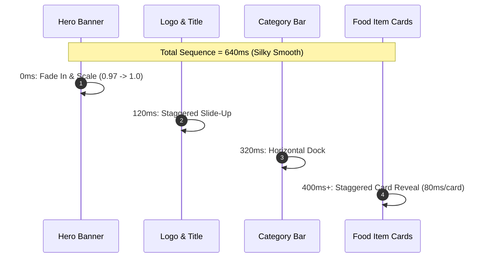

# Interaction & Motion Design Guidelines — DigiNu

**Document Version:** 1.0  
**Phase:** 03 — UI/UX Design, Branding & Design System  
**Status:** DRAFT — REVIEW REQUIRED  
**Project:** DigiNu — Reusable QR-Based Digital Restaurant Menu Platform  

---

## 1. Motion Philosophy: Tactile, Purposeful, Performant

In DigiNu, animation is an essential UX affordance, not decorative clutter:

* **Tactile Physics:** Micro-interactions mimic the organic resistance and snap of physical cards and switches.
* **Appetite Engagement:** Smooth reveals draw attention to culinary textures and dish descriptions.
* **Performance Budget:** All animations strictly target 60–120 FPS on mobile devices by animating **only GPU-accelerated properties** (`transform` and `opacity`). Animating layout-triggering properties (`height`, `width`, `top`, `padding`) is strictly prohibited.

---

## 2. Motion Token Catalog

```
+-----------------------------------------------------------------------------------------+
|                                  MOTION TOKEN CATALOG                                   |
+-----------------------------------------------------------------------------------------+
| Token Name          | Value               | Applied Scenario                            |
|---------------------|---------------------|---------------------------------------------|
| `--motion-instant`  | `100ms`             | Button press, switch tap, checkbox toggle   |
| `--motion-fast`     | `200ms`             | Card hover, tooltip reveal, category pill   |
| `--motion-normal`   | `300ms`             | Modal entrance, search card filter update   |
| `--motion-relaxed`  | `450ms`             | Drawer expansion, hero banner reveal        |
| `--motion-slow`     | `600ms`             | Staggered page load sequence                |
|---------------------|---------------------|---------------------------------------------|
| `--ease-out-cubic`  | `(0.33, 1, 0.68, 1)`| General exit and settling transitions       |
| `--ease-in-out`     | `(0.65, 0, 0.35, 1)`| Symmetrical state toggles                   |
| `--spring-gentle`   | `(0.16, 1, 0.3, 1)` | Bottom sheets, drawers, expanding modals    |
| `--spring-snappy`   | `(0.34, 1.56, 0.64, 1)`| 86 toggle thumb, active category pill snap|
+-----------------------------------------------------------------------------------------+
```

---

## 3. Choreographed Animation Workflows

### 3.1 Public Menu Page Entrance Sequence
When a customer scans a table QR code, components reveal in a carefully orchestrated stagger:
1. **Time 0ms:** Cover banner fades in with gentle scale (`scale(0.97) -> scale(1.0)`, 450ms).
2. **Time 120ms:** Restaurant logo and title slide upward (`translateY(24px) -> translateY(0)`, 350ms).
3. **Time 240ms:** Operational status badge and contact pills slide in.
4. **Time 320ms:** Sticky category navigation bar docks into position.
5. **Time 400ms:** First 4 food item cards reveal sequentially with an **80ms stagger interval** per card.



---

### 3.2 Category Navigation Scroll-Spy Interaction
* **Behavior:** As the user scrolls through the menu:
  - An animated active indicator pill glides smoothly behind the active category chip using Framer Motion's `layoutId="activeCategoryPill"`.
  - The horizontal category container auto-scrolls to ensure the active category remains visible and centered in the mobile viewport.
* **Physics:** Uses `--spring-snappy` for instant visual lock-on without sluggish drag.

---

### 3.3 Food Item Card Interactions
* **Touch Press Feedback:** On mobile touch or mouse click, the card depresses subtly (`scale(0.985)`, 100ms) before opening the detail drawer.
* **Desktop Hover:** Food image scales gently within its overflow-hidden container (`scale(1.04)`, 300ms ease-out) while card elevates (`shadow-sm -> shadow-md`).
* **Sold Out (86) Transition:** When an item is marked unavailable in the kitchen, the card cross-fades from 100% to **50% opacity** over 300ms, and the `[Sold Out Today]` badge scales in with a slight spring pop (`scale(0.8) -> scale(1.0)`).

---

### 3.4 Dish Detail Bottom Sheet (Drawer)
* **Entrance:** Springs up from the bottom of the viewport (`translateY(100%) -> translateY(0)`) using `--spring-gentle` (350ms).
* **Backdrop:** Background dims to 40% black with `backdrop-blur(4px)` over 250ms.
* **Exit:** Dismissing animates cleanly down (`translateY(100%)`, 250ms) while restoring exact scroll position without layout shift.

---

### 3.5 AI Culinary Studio Signature UI Experience
The AI generation modal features a dedicated motion choreography:
1. **Trigger:** Clicking `[Generate with AI]` disables the button and activates an ambient culinary shimmer border around the prompt preview box.
2. **Generating State:** A warm ambient pulsating glow (`opacity: 0.4 -> 0.8 -> 0.4`, 2s loop) indicates neural processing.
3. **Image Reveal:** When the image buffer returns from Cloudflare Workers AI (~3s), the placeholder cross-fades into the high-resolution photo with an elegant blur-up transition (`blur(12px) -> blur(0)`, 400ms).
4. **Approval Feedback:** Clicking `[Approve]` triggers a celebratory green checkmark spring pop, and the modal gracefully closes.

---

## 4. Accessibility & Reduced Motion Standards (`prefers-reduced-motion`)

To protect users with vestibular disorders, all animations strictly adhere to media query overrides:

```css
@media (prefers-reduced-motion: reduce) {
  *, ::before, ::after {
    animation-duration: 0.01ms !important;
    animation-iteration-count: 1 !important;
    transition-duration: 0.01ms !important;
    scroll-behavior: auto !important;
  }
  
  /* Replace scale/slide animations with instant cross-fades */
  .detail-drawer {
    transform: none !important;
    opacity: 1 !important;
  }
}
```

* When reduced motion is active, all layout position transforms (`translateY`, `scale`) are disabled. Content appears instantaneously, maintaining 100% operational functionality without motion.

