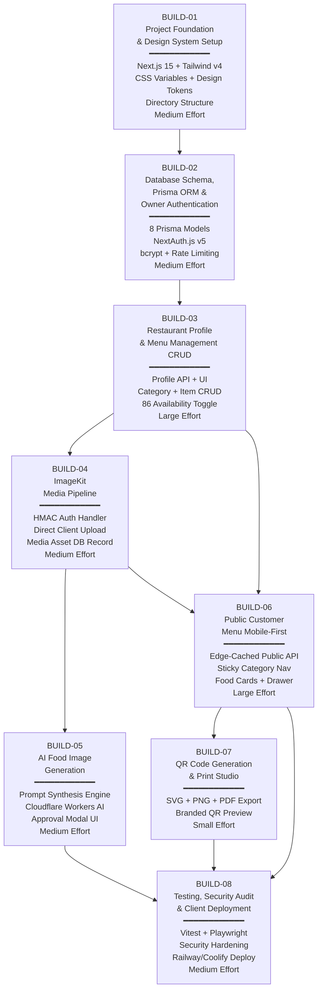

# Master Implementation Roadmap — DigiNu Phase 04

**Document Version:** 1.0  
**Phase:** 04 — Implementation Planning  
**Status:** IN PROGRESS  
**Project:** DigiNu — Reusable QR-Based Digital Restaurant Menu Platform  

---

## 1. Implementation Strategy

The DigiNu platform is built across **8 sequenced BUILD phases** designed for a solo developer to achieve continuous, testable progress. Each phase has a clear input (approved prior phase), defined deliverables, and an explicit approval gate before the next phase begins.

**Core Principle:** Every phase produces working, tested code. No phase ends with half-implemented features.

---

## 2. Phase Dependency Flowchart

---

## 3. Phase Summaries

### BUILD-01: Project Foundation & Design System Setup

| Field | Detail |
|:---|:---|
| **Phase ID** | BUILD-01 |
| **Effort Estimate** | Medium (1–2 days) |
| **Objective** | Initialize the production-ready Next.js 15 project, configure all tooling, and implement the complete design token system as CSS custom properties |
| **Business Value** | Creates the reusable project template that all restaurant deployments will clone. Getting this right eliminates tech debt across every future deployment. |
| **Prerequisites** | Node.js 20+ installed; npm/pnpm available |
| **Key Deliverables** | Initialized Next.js 15 App Router project; Tailwind CSS v4 with design tokens as CSS variables; full directory structure per approved repo plan; `.env.example`; Google Fonts loaded; global CSS variables for all 3 theme presets |
| **PRD Requirements** | FR-REUSE-001 (foundation), FR-SEC-001 (middleware setup) |
| **Screens** | N/A (infrastructure only) |
| **API Endpoints** | None |
| **DB Changes** | None |
| **Definition of Done** | `npm run build` succeeds; `npm run dev` starts; Tailwind classes with custom CSS variables render correctly; TypeScript strict mode enabled |
| **Effort Justification** | Medium because Next.js 15 App Router + Tailwind v4 CSS variables configuration has non-trivial nuances (server/client component boundaries, CSS layer setup, font optimization) |

---

### BUILD-02: Database Schema, Prisma ORM & Owner Authentication

| Field | Detail |
|:---|:---|
| **Phase ID** | BUILD-02 |
| **Effort Estimate** | Medium (2–3 days) |
| **Objective** | Configure Prisma ORM with PostgreSQL, create all 8 single-restaurant database models, implement NextAuth.js v5 credentials provider, and seed the initial owner account |
| **Business Value** | Establishes the entire data foundation. Every subsequent feature depends on these models existing and being correctly typed. |
| **Prerequisites** | BUILD-01 complete; PostgreSQL database URL available; AUTH_SECRET generated |
| **Key Deliverables** | `prisma/schema.prisma` with all 8 models; initial migration; `prisma/seed.ts`; NextAuth.js v5 credentials provider; bcrypt password hashing; session middleware; login/logout UI (SCR-ADMIN-01) |
| **PRD Requirements** | FR-AUTH-001, FR-AUTH-002, FR-REUSE-002 |
| **Screens** | SCR-ADMIN-01 (Login Screen) |
| **API Endpoints** | `POST /api/auth/[...nextauth]` |
| **DB Changes** | All 8 models: `restaurant_profile`, `owner_account`, `menu_categories`, `menu_items`, `media_assets`, `operating_hours`, `qr_code_config`, `ai_generation_logs` |
| **Definition of Done** | Migration runs clean; seed creates profile + owner; login sets HttpOnly cookie; `/admin` redirects unauthenticated requests to `/admin/login` |
| **Effort Justification** | Medium — NextAuth.js v5 Credentials provider has specific configuration nuances; password hashing + rate limiting require careful implementation |

---

### BUILD-03: Restaurant Profile & Menu Management (CRUD)

| Field | Detail |
|:---|:---|
| **Phase ID** | BUILD-03 |
| **Effort Estimate** | Large (4–6 days) |
| **Objective** | Build the complete owner dashboard CRUD: restaurant profile settings, category management with reordering, food item creation/editing with dietary tags, and the 1-tap 86 availability toggle |
| **Business Value** | The core value proposition for restaurant owners. This phase makes the product commercially usable for menu management without requiring any other phases. |
| **Prerequisites** | BUILD-02 complete; authenticated session working |
| **Key Deliverables** | Admin dashboard overview (SCR-ADMIN-02); Profile management (SCR-ADMIN-03); Category CRUD with reorder (SCR-ADMIN-04); Food item CRUD with dietary tags and 86 toggle (SCR-ADMIN-05, SCR-ADMIN-06) |
| **PRD Requirements** | FR-PROF-001, FR-PROF-003, FR-PROF-004, FR-CAT-001, FR-CAT-002, FR-CAT-003, FR-ITEM-001, FR-ITEM-003, FR-ITEM-004, FR-ITEM-005 |
| **Screens** | SCR-ADMIN-02, SCR-ADMIN-03, SCR-ADMIN-04, SCR-ADMIN-05, SCR-ADMIN-06 |
| **API Endpoints** | `PATCH /api/admin/profile`, `PATCH /api/admin/profile/hours`, `POST/PATCH/DELETE /api/admin/categories`, `PUT /api/admin/categories/reorder`, `POST/PUT/DELETE /api/admin/items`, `PATCH /api/admin/items/:id/availability`, `PUT /api/admin/items/reorder` |
| **DB Changes** | None (models from BUILD-02); migrations for `display_order` index if not in initial schema |
| **Definition of Done** | Full CRUD works for all entities; delete safeguards enforced; 86 toggle updates live; reordering persists to DB; Zod validation on all inputs |
| **Effort Justification** | Large — 7+ API routes, 5 screens, complex form validation, drag-and-drop reordering, optimistic UI for availability toggle |

---

### BUILD-04: ImageKit Media Pipeline

| Field | Detail |
|:---|:---|
| **Phase ID** | BUILD-04 |
| **Effort Estimate** | Medium (2–3 days) |
| **Objective** | Implement the complete ImageKit media pipeline: HMAC-SHA1 auth token generation, direct client-side upload to ImageKit CDN, metadata persistence to `media_assets`, and media library browser |
| **Business Value** | Enables restaurant owners to attach real food photography to dishes, dramatically improving the quality and commercial appeal of the digital menu. |
| **Prerequisites** | BUILD-03 complete; ImageKit account credentials (Public Key, Private Key, URL Endpoint) available |
| **Key Deliverables** | `GET /api/admin/media/imagekit-auth`; `POST /api/admin/media/confirm`; ImageKit direct upload client component; Media Library screen (SCR-ADMIN-07); Logo/banner upload in profile; dish image attachment |
| **PRD Requirements** | FR-PROF-002, FR-ITEM-002, FR-SEC-003 |
| **Screens** | SCR-ADMIN-07 (Media Library); portions of SCR-ADMIN-03, SCR-ADMIN-06 |
| **API Endpoints** | `GET /api/admin/media/imagekit-auth`, `POST /api/admin/media/confirm` |
| **DB Changes** | `media_assets` table (created in BUILD-02); no new models |
| **Definition of Done** | Logo/banner upload succeeds and URL stored in DB; food image uploads to correct ImageKit folder; non-image files rejected; EXIF stripped by ImageKit; asset URL renders in dashboard and public menu |
| **Effort Justification** | Medium — HMAC signature generation is non-trivial; direct upload flow has async confirmation step; MIME validation and error handling require careful implementation |

---

### BUILD-05: AI Food Image Generation (Cloudflare Workers AI)

| Field | Detail |
|:---|:---|
| **Phase ID** | BUILD-05 |
| **Effort Estimate** | Medium (2–3 days) |
| **Objective** | Build the complete AI Food Image Studio: culinary prompt synthesis engine, Cloudflare Workers AI adapter (flux-1-schnell), 1-image preview modal, mandatory approval workflow, quota enforcement |
| **Business Value** | The primary commercial differentiator. Enables restaurants without photography budgets to have studio-quality food images. This feature justifies a significant portion of the monthly SaaS fee. |
| **Prerequisites** | BUILD-04 complete; Cloudflare Account ID and API Token available; `ai_credits_balance` initialized by seed |
| **Key Deliverables** | `lib/prompt-synthesizer.ts`; `lib/ai-generator.ts`; `POST /api/admin/ai/generate`; `POST /api/admin/ai/approve`; `AIStudioModal.tsx` component with 1-image preview, Approve & Regenerate buttons; quota display in dashboard |
| **PRD Requirements** | FR-AI-001, FR-AI-002, FR-AI-003, FR-AI-004, FR-AI-005, FR-AI-006, FR-SEC-004 |
| **Screens** | SCR-ADMIN-08 (AI Studio Modal); SCR-ADMIN-02 (credit counter) |
| **API Endpoints** | `POST /api/admin/ai/generate`, `POST /api/admin/ai/approve` |
| **DB Changes** | `ai_generation_logs` (created in BUILD-02); `restaurant_profile.ai_credits_balance` decremented on approval |
| **Definition of Done** | Generate returns base64 preview in < 10s; modal shows preview with Approve/Regenerate; approve saves to ImageKit, links to dish, decrements credit; balance=0 blocks generation server-side; timeout handled gracefully |
| **Effort Justification** | Medium — Cloudflare Workers AI REST API integration with base64 image buffer handling; ImageKit server-side upload from buffer; quota atomicity; timeout handling |

---

### BUILD-06: Public Customer Menu (Mobile-First)

| Field | Detail |
|:---|:---|
| **Phase ID** | BUILD-06 |
| **Effort Estimate** | Large (4–5 days) |
| **Objective** | Build the complete public-facing customer menu: edge-cached public API, restaurant hero header, sticky scroll-spy category navigation, food item cards, dish detail bottom sheet, live search, and sold-out states |
| **Business Value** | The primary customer-facing experience. This is what every diner sees when they scan the QR code. Performance and mobile UX quality directly impact customer satisfaction and restaurant retention. |
| **Prerequisites** | BUILD-03 complete (category + item data); BUILD-04 optional but recommended (images) |
| **Key Deliverables** | `GET /api/public/menu` (edge-cached); `MenuHeader.tsx`; `CategoryNav.tsx`; `MenuItemCard.tsx`; `DishDetailDrawer.tsx`; `LiveSearchBar.tsx`; `not-found.tsx`; sold-out styling; outside-hours banner |
| **PRD Requirements** | FR-MENU-001 through FR-MENU-007, FR-SEC-002, FR-SEC-005 |
| **Screens** | SCR-CUST-01, SCR-CUST-02, SCR-CUST-03, SCR-CUST-04, SCR-CUST-05, SCR-CUST-06 |
| **API Endpoints** | `GET /api/public/menu` |
| **DB Changes** | None |
| **Definition of Done** | Public menu renders in < 1.5s on 4G (Lighthouse). Scroll-spy highlights active category. Sold-out items show at 50% opacity with badge. Search filters client-side. Zero cookies set. No passwords/emails in public JSON. |
| **Effort Justification** | Large — 6 screen states, scroll-spy implementation, Bottom Sheet drawer with spring physics, mobile performance optimization, image lazy loading, edge caching configuration |

---

### BUILD-07: QR Code Generation & Print Studio

| Field | Detail |
|:---|:---|
| **Phase ID** | BUILD-07 |
| **Effort Estimate** | Small (1–2 days) |
| **Objective** | Build the QR Code Studio: generate a branded QR code encoding the restaurant's public menu URL, with live preview, logo embedding, and multi-format download (SVG, 300 DPI PNG, A6 table-tent PDF) |
| **Business Value** | The physical bridge between the restaurant's printed table materials and the digital menu. QR codes are deliverables that restaurant owners distribute to tables, menus, and marketing materials. |
| **Prerequisites** | BUILD-06 complete (public menu URL exists and resolves) |
| **Key Deliverables** | `lib/qr-generator.ts`; `GET /api/admin/qr-code/preview`; `GET /api/admin/qr-code/download?format=svg|png|pdf`; `QRPreview.tsx` component; QR Studio screen (SCR-ADMIN-09) |
| **PRD Requirements** | FR-QR-001, FR-QR-002, FR-QR-003 |
| **Screens** | SCR-ADMIN-09 (QR Studio) |
| **API Endpoints** | `GET /api/admin/qr-code/preview`, `GET /api/admin/qr-code/download` |
| **DB Changes** | `qr_code_config` (created in BUILD-02); `download_count` incremented on each download |
| **Definition of Done** | QR code scans successfully on iOS and Android. SVG downloads with infinite scalability. PNG is exactly 2048×2048. PDF is A6 table-tent format. Logo embedding works without breaking scannability. |
| **Effort Justification** | Small — `qrcode` library handles most complexity; pdfkit for PDF; primary effort is UI and format-specific export handling |

---

### BUILD-08: Testing, Security Audit & Client Deployment Workflow

| Field | Detail |
|:---|:---|
| **Phase ID** | BUILD-08 |
| **Effort Estimate** | Medium (3–4 days) |
| **Objective** | Execute comprehensive testing (Vitest unit/integration, Playwright E2E), perform a thorough security audit, achieve Lighthouse performance targets, and validate the complete client deployment workflow |
| **Business Value** | Transforms the codebase from functional to production-grade and commercially sellable. Security audit protects the freelancer's reputation. Performance targets protect diner experience. |
| **Prerequisites** | BUILD-05, BUILD-06, BUILD-07 all complete |
| **Key Deliverables** | Vitest suite for all API routes and utility functions; Playwright E2E for critical user journeys (diner browses menu, owner logs in and 86s a dish, QR code downloads); security hardening; Lighthouse CI; Railway/Coolify deployment guide |
| **PRD Requirements** | All FR-SEC-* verification; NFR performance targets; deployment workflow |
| **Screens** | All screens final visual QA |
| **API Endpoints** | All endpoints covered by tests |
| **DB Changes** | None |
| **Definition of Done** | Lighthouse Performance ≥ 90 (mobile). Zero axe-core accessibility violations. All Vitest tests pass. All Playwright E2E scenarios pass. Zero hardcoded secrets in codebase. Owner deployment checklist verified on fresh database. |
| **Effort Justification** | Medium — test suite authoring is time-consuming but critically important; E2E test setup with Playwright requires environment configuration; security audit is methodical |

---

## 4. Effort Summary

| Phase | Effort | Days Estimate | Cumulative |
|:---:|:---:|:---:|:---:|
| BUILD-01 | Medium | 1–2 days | 1–2 days |
| BUILD-02 | Medium | 2–3 days | 3–5 days |
| BUILD-03 | Large | 4–6 days | 7–11 days |
| BUILD-04 | Medium | 2–3 days | 9–14 days |
| BUILD-05 | Medium | 2–3 days | 11–17 days |
| BUILD-06 | Large | 4–5 days | 15–22 days |
| BUILD-07 | Small | 1–2 days | 16–24 days |
| BUILD-08 | Medium | 3–4 days | 19–28 days |

**Total Estimated Development Time:** 19–28 working days (4–6 weeks for a solo developer)

> [!NOTE]
> Estimates assume a developer familiar with Next.js 15 App Router, TypeScript, Prisma, and Tailwind CSS. First-time familiarity with Cloudflare Workers AI or ImageKit SDK may add 1–2 days to BUILD-04 and BUILD-05.

