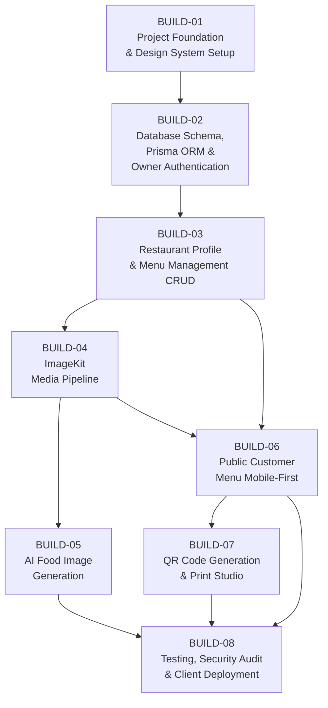

# Dependency & Traceability Matrix — DigiNu Phase 04

**Document Version:** 1.0  
**Phase:** 04 — Implementation Planning  
**Status:** IN PROGRESS  
**Project:** DigiNu — Reusable QR-Based Digital Restaurant Menu Platform  

---

## 1. Full Dependency Graph

### Dependency Rationale

| Phase | Depends On | Reason |
|:---|:---|:---|
| BUILD-02 | BUILD-01 | Prisma requires Next.js project initialized; auth.ts requires the app structure |
| BUILD-03 | BUILD-02 | Category/item CRUD requires Prisma models + authenticated session middleware |
| BUILD-04 | BUILD-03 | ImageKit uploader attaches to dish forms + profile; restaurant_profile.slug needed for folder scoping |
| BUILD-05 | BUILD-04 | AI approval writes to `media_assets` via ImageKit; dish detail must exist for prompt synthesis |
| BUILD-06 | BUILD-03 | Public menu consumes categories + items; B04 optional (renders without images gracefully) |
| BUILD-06 | BUILD-04 | Full image display on public menu requires confirmed ImageKit URL structure |
| BUILD-07 | BUILD-06 | QR code encodes the public menu URL; `qr_code_config` initialized during B02 migration |
| BUILD-08 | BUILD-05, BUILD-06, BUILD-07 | All features must exist before final testing, security audit, and deployment |

---

## 2. Requirements Traceability Matrix (RTM)

### 2.1 Must-Have Requirements

| PRD Req ID | User Story | Screen ID | Database Entity | API Endpoint | Build Phase | Test Case | Acceptance Gate |
|:---|:---|:---|:---|:---|:---:|:---|:---|
| **FR-MENU-001** | US-CUST-001: As a diner, I scan a QR code and the menu loads instantly | SCR-CUST-01 | `restaurant_profile` | `GET /api/public/menu` | BUILD-06 | TC-M001: Valid slug → 200 OK < 1.5s; Invalid slug → 404 fallback | Menu renders in < 1.5s on 4G. Zero stack traces on invalid slug. |
| **FR-MENU-002** | US-CUST-001: I see the restaurant name, logo, banner, and operating status | SCR-CUST-01 | `restaurant_profile`, `operating_hours`, `media_assets` | `GET /api/public/menu` | BUILD-06 | TC-M002: Header renders logo, banner, name, tagline, status badge | All branding assets visible. Phone tap opens dialer. |
| **FR-MENU-003** | US-CUST-002: Category nav sticks and scroll-spy highlights active section | SCR-CUST-02 | `menu_categories` | `GET /api/public/menu` | BUILD-06 | TC-M003: Category bar docks at top; active tab highlights on scroll | Category bar sticky. Tap jumps to section. Auto-highlight on scroll. |
| **FR-MENU-004** | US-CUST-003: I can read dish cards with photo, price, and dietary indicators | SCR-CUST-02 | `menu_items`, `media_assets` | `GET /api/public/menu` | BUILD-06 | TC-M004: Card renders WebP image, price formatted per currency, Veg/Non-Veg dot, dietary chips | Price formats correctly. Missing image renders text-first gracefully. |
| **FR-MENU-005** | US-CUST-004: Sold-out dishes are clearly marked | SCR-CUST-05 | `menu_items` | `GET /api/public/menu` | BUILD-06 | TC-M005: `is_available=false` → 50% opacity + "SOLD OUT TODAY" badge | Cannot confuse sold-out with available. |
| **FR-AUTH-001** | US-OWN-001: Owner logs in securely with email/password | SCR-ADMIN-01 | `owner_account` | `POST /api/auth/[...nextauth]` | BUILD-02 | TC-A001: Valid creds → HttpOnly cookie; Invalid → generic error; 5+ fails → 429 | Cookies have HttpOnly, Secure, SameSite=Lax flags. Rate limit enforced. |
| **FR-AUTH-002** | US-OWN-002: Unauthenticated /admin access is blocked | SCR-ADMIN-01 | `owner_account` | Auth Middleware | BUILD-02 | TC-A002: No session → redirect /admin/login; Logout → cookie cleared | Direct /admin access without session → redirected. |
| **FR-PROF-001** | US-OWN-003: Owner updates restaurant name, address, phone | SCR-ADMIN-03 | `restaurant_profile` | `PATCH /api/admin/profile` | BUILD-03 | TC-P001: Updated fields persist; reflected in public menu | Changes save immediately; public menu shows updated info. |
| **FR-PROF-002** | US-OWN-003: Owner uploads logo and cover banner | SCR-ADMIN-03, SCR-ADMIN-07 | `media_assets`, `restaurant_profile` | `GET /api/admin/media/imagekit-auth`, `POST /api/admin/media/confirm` | BUILD-04 | TC-P002: Upload succeeds; asset saved in DB; ImageKit URL returned | File validated MIME; >5MB rejected; ImageKit URL confirmed. |
| **FR-PROF-003** | US-OWN-003: Owner selects brand color and theme | SCR-ADMIN-03 | `restaurant_profile` | `PATCH /api/admin/profile` | BUILD-03 | TC-P003: Saved color applies to `--brand-primary` CSS variable on public menu | Public menu accent colors match selected primary color. |
| **FR-CAT-001** | US-CAT-001: Owner creates, edits, deletes categories | SCR-ADMIN-04 | `menu_categories` | `POST`, `PATCH`, `DELETE /api/admin/categories` | BUILD-03 | TC-C001: CRUD persists; delete with dishes → 409; category appears in public menu | Deletion of non-empty category blocked with clear error. |
| **FR-CAT-002** | US-CAT-002: Owner reorders categories and sequence persists | SCR-ADMIN-04 | `menu_categories` | `PUT /api/admin/categories/reorder` | BUILD-03 | TC-C002: Reordered sequence saved; public menu reflects new order | Public menu categories match saved display_order. |
| **FR-ITEM-001** | US-ITEM-001: Owner creates dishes with all attributes | SCR-ADMIN-05, SCR-ADMIN-06 | `menu_items` | `POST /api/admin/items` | BUILD-03 | TC-I001: Dish saves with valid fields; rejects missing Name/Category/Price | Name, Category, Price required; price >= 0 enforced. |
| **FR-ITEM-003** | US-ITEM-001: Veg/Non-Veg and dietary tags render on card | SCR-ADMIN-06 | `menu_items` | `POST /api/admin/items` | BUILD-03 | TC-I003: Veg=true → green dot; dietary flags → chips on public card | Public menu correctly renders Veg/Non-Veg and dietary indicators. |
| **FR-ITEM-004** | US-ITEM-002: Owner toggles dish availability in 1 tap | SCR-ADMIN-05 | `menu_items` | `PATCH /api/admin/items/:id/availability` | BUILD-03 | TC-I004: Toggle updates `is_available`; public menu reflects within 60s | Optimistic UI updates immediately; server confirms within 500ms. |
| **FR-ITEM-002** | US-ITEM-003: Owner attaches image via upload, library, or AI | SCR-ADMIN-06, SCR-ADMIN-07 | `menu_items`, `media_assets` | `PATCH /api/admin/items/:id` | BUILD-04 | TC-I002: Image attached to dish; displayed in dashboard and public menu | Image appears in dashboard preview and public dish card. |
| **FR-AI-001** | US-AI-001: Backend synthesizes culinary prompt from dish data | SCR-ADMIN-08 | — | `POST /api/admin/ai/generate` | BUILD-05 | TC-AI001: Prompt includes dish name, description, camera angle, lighting, negatives | Prompt never sends raw user input unformatted. |
| **FR-AI-002** | US-AI-001: 1 high-res image generated per request | SCR-ADMIN-08 | `ai_generation_logs` | `POST /api/admin/ai/generate` | BUILD-05 | TC-AI002: Response contains previewUrl (base64); ~250 Neurons consumed | Returns exactly 1 image. Neuron count logged. |
| **FR-AI-003** | US-AI-002: Owner inspects generated photo in preview modal | SCR-ADMIN-08 | — | Modal Component | BUILD-05 | TC-AI003: Modal renders photo preview; Approve + Regenerate buttons visible | Owner can zoom image. Approve and Regenerate buttons are accessible. |
| **FR-AI-004** | US-AI-002: Approved image saved to ImageKit and attached to dish | SCR-ADMIN-08 | `media_assets`, `menu_items`, `ai_generation_logs` | `POST /api/admin/ai/approve` | BUILD-05 | TC-AI004: ImageKit URL returned; `menu_items.image_asset_id` updated; credit decremented | Image never auto-assigned. Credit balance decremented by exactly 1. |
| **FR-AI-005** | US-AI-003: AI failure shows toast; dish text saves normally | SCR-ADMIN-08 | — | `POST /api/admin/ai/generate` | BUILD-05 | TC-AI005: Cloudflare timeout → 503 toast; dish remains editable | AI failure does not block dish text saving. |
| **FR-AI-006** | US-AI-001: Monthly quota enforced per deployment | SCR-ADMIN-08 | `restaurant_profile` | `POST /api/admin/ai/generate` | BUILD-05 | TC-AI006: Balance=0 → 402 "No credits"; double-click locked | Server-side quota check before calling Cloudflare API. |
| **FR-QR-001** | US-QR-001: QR code encodes canonical public menu URL | SCR-ADMIN-09 | `qr_code_config` | `GET /api/admin/qr-code/preview` | BUILD-07 | TC-QR001: Scan QR → navigates to `NEXT_PUBLIC_APP_URL/`; scannable on iOS & Android | iOS and Android camera apps successfully scan and navigate. |
| **FR-QR-003** | US-QR-002: Download SVG, PNG, and PDF formats | SCR-ADMIN-09 | `qr_code_config` | `GET /api/admin/qr-code/download?format=...` | BUILD-07 | TC-QR003: SVG scales infinitely; PNG is 2048×2048; PDF is A6 table-tent | All 3 formats download correctly without errors. |
| **FR-REUSE-001** | — | All | All Entities | All Endpoints | ALL | TC-RE001: Zero hardcoded restaurant names, colors, or slugs in codebase | 100% DB/ENV driven configuration. |
| **FR-REUSE-002** | — | Infrastructure | Dedicated DB | Prisma | BUILD-02 | TC-RE002: Independent PostgreSQL database; no cross-deployment queries possible | Physical isolation verified by independent DB provisioning. |
| **FR-SEC-001** | — | SCR-CUST-* | — | Public Middleware | ALL | TC-SE001: POST/PUT/PATCH/DELETE to /api/public/* returns 405 | Zero mutations on public route. |
| **FR-SEC-002** | — | SCR-CUST-* | — | `GET /api/public/menu` | BUILD-06 | TC-SE002: Response contains no password_hash, email, or draft items | Manual inspection of public JSON payload. |
| **FR-SEC-003** | — | SCR-ADMIN-07 | `media_assets` | ImageKit Upload | BUILD-04 | TC-SE003: .exe disguised as .jpg → rejected; EXIF stripped | File magic number validation test with crafted test file. |
| **FR-SEC-004** | — | — | — | `/api/admin/ai/*` | BUILD-05 | TC-SE004: Browser network tab shows no Cloudflare API token | Network inspection confirms secrets never reach client. |
| **FR-SEC-005** | — | SCR-CUST-* | — | Public Client | BUILD-06 | TC-SE005: No Set-Cookie headers on public menu response | Zero cookies set for anonymous diners. |

### 2.2 Should-Have Requirements

| PRD Req ID | Feature | Screen ID | Build Phase | Acceptance Gate |
|:---|:---|:---|:---:|:---|
| **FR-MENU-006** | Dish Detail Bottom Sheet | SCR-CUST-03 | BUILD-06 | Drawer opens/closes smoothly; dismissible by tap-outside, drag-down, Escape; focus trapped while open |
| **FR-MENU-007** | Live Search & Dietary Filter | SCR-CUST-04 | BUILD-06 | Search debounced 150ms; Veg/GF/Chef's Picks chips work; empty state shown |
| **FR-PROF-004** | Operating Hours Configuration | SCR-ADMIN-03 | BUILD-03 | 7-day schedule saves; public menu shows Open Now / Closed badge |
| **FR-CAT-003** | Category Visibility Toggle | SCR-ADMIN-04 | BUILD-03 | Hidden category disappears from public menu without deleting data |
| **FR-ITEM-005** | Item Reordering within Category | SCR-ADMIN-05 | BUILD-03 | Saved order sequence reflects on public menu |
| **FR-QR-002** | Branded QR Customization | SCR-ADMIN-09 | BUILD-07 | Logo embedded in QR center; primary color applied; QR remains scannable |

### 2.3 Deferred Post-MVP (Out of Scope for BUILD-01 through BUILD-08)

| Feature | Phase Deferred To | Notes |
|:---|:---:|:---|
| Table-Specific QR Codes | V2 | `?table=N` routing |
| Multi-Language Toggle | V2 | i18n library required |
| Bulk CSV Import | V2 | Menu onboarding shortcut |
| Analytics Dashboard | V2 | Privacy-preserving scan counters |
| Staff Permissions (RBAC) | V2 | Floor staff vs. owner roles |

---

## 3. Must-Have Requirement Phase Assignment Verification

All 29 Must-Have requirements are assigned to exactly one BUILD phase. No requirement is left unassigned:

| Phase | Must-Have Reqs Addressed |
|:---:|:---|
| BUILD-01 | FR-REUSE-001 (foundation), FR-SEC-001 (middleware setup) |
| BUILD-02 | FR-AUTH-001, FR-AUTH-002, FR-REUSE-002 |
| BUILD-03 | FR-PROF-001, FR-PROF-003, FR-CAT-001, FR-CAT-002, FR-ITEM-001, FR-ITEM-003, FR-ITEM-004 |
| BUILD-04 | FR-PROF-002, FR-ITEM-002, FR-SEC-003 |
| BUILD-05 | FR-AI-001, FR-AI-002, FR-AI-003, FR-AI-004, FR-AI-005, FR-AI-006, FR-SEC-004 |
| BUILD-06 | FR-MENU-001, FR-MENU-002, FR-MENU-003, FR-MENU-004, FR-MENU-005, FR-SEC-002, FR-SEC-005 |
| BUILD-07 | FR-QR-001, FR-QR-003 |
| BUILD-08 | Verification, security audit, and deployment of all above |

**✅ All 29 Must-Have requirements mapped. No gaps.**

